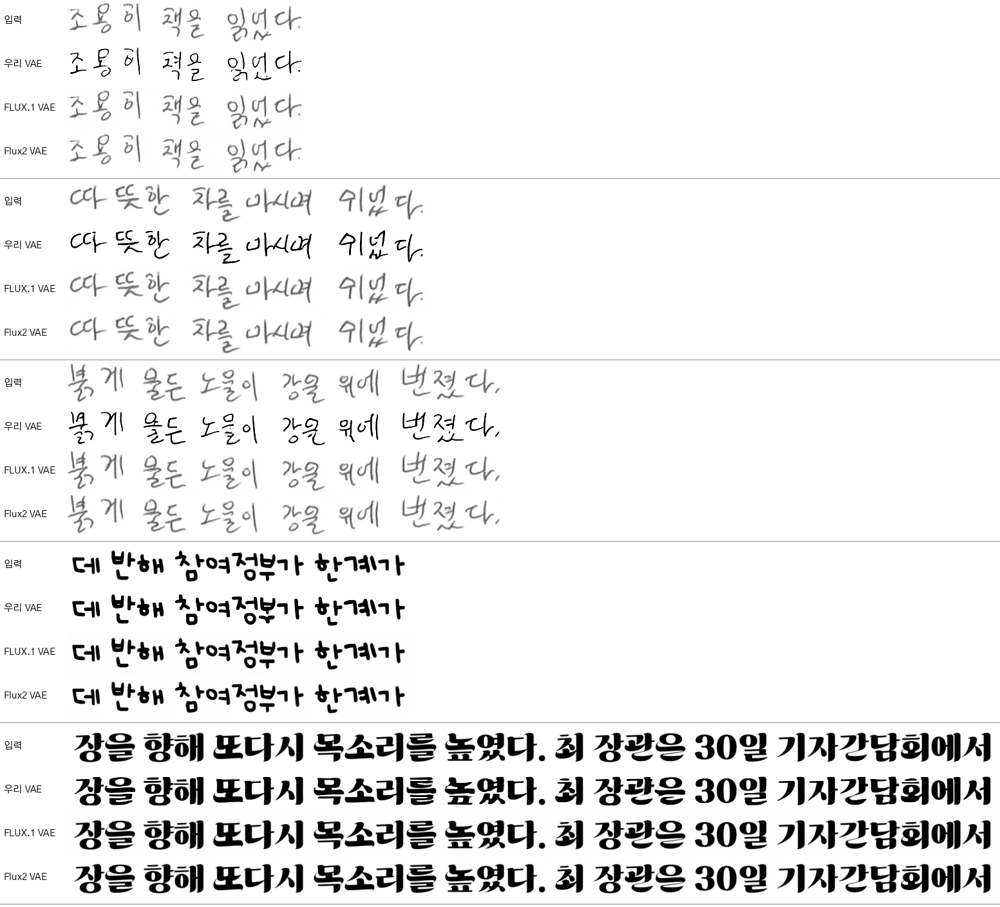
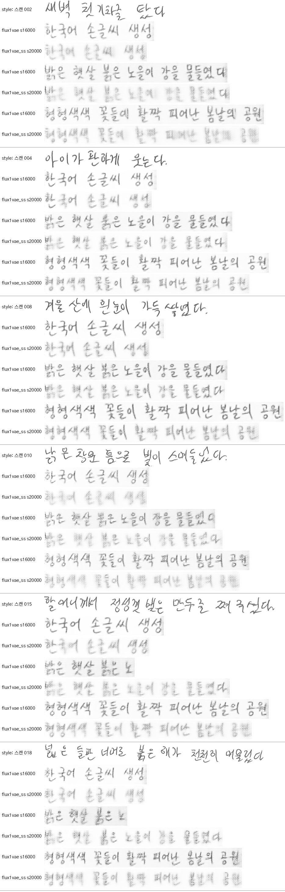

# 실험 로그 — 측정 결과 전문

README 에서 분리한 **측정 기록**이다. 코드에 반영된 결론만 보려면
[README 「결과 요약」](../README.md#결과-요약) 을 보면 된다. 여기엔 그 결론을 뒷받침하는
수치·표·재현 커맨드를 시간순으로 남긴다.

| 절 | 주제 | 한 줄 결론 |
|---|---|---|
| §1 | 초기 실험 (2026-06) | lr 5e-5 는 영어 init 에서 발산, 1e-5 안정. 한글 glyph 는 신규 학습이라 scale 필요 |
| §2 | echo 정량 비교 (2026-07) | v2 20k 가 fidelity 정점. 픽셀 지표는 정렬오차에 민감 → CER 로 재측정 |
| §3 | VAE 한글 수용성 (2026-07) | 한글 재구성 오차 = 영어의 ~12배. **이것이 한글 fidelity 하드상한** |
| §4 | VAE 한글 적응 (2026-07) | full(enc+dec) 적응으로 roundtrip MSE −83%. HTR loss 는 켠다(§11). log_var·pyramid 는 이득 없음 |
| §5 | Eruku 재적응 (2026-07) | 단문강조 재적응으로 한글 CER 0.211 → 0.127, 단문 0.54 → 0.29 |
| §6 | VAE 강건성 | 실제 손글씨는 여백이 latent std 를 6~29배로 튀김 → ink bbox 크롭 |
| §7 | 종성 획 손실 (2026-08) | 겹받침 음절정확도가 홑받침보다 22%p 낮음, 손실의 3/4 은 생성 단계. FLUX VAE 는 받침 손실이 유형 무관하게 평평(진행 중) |
| §8 | 폰트 풀 156배 (2026-09) | seen 단문 중앙값 0.133 → **0.000**, 미노출 writer 는 상한 포화로 판정불가 |
| §9 | 코퍼스 35배 (2026-09) | 자연어 음절 32%→90%. seen 평균 0.084 → **0.069**, **폭주율 1.0% → 0.3%**(VAE 상한과 동률) |
| §10 | VAE 폰트 156배 (2026-09) | 손글씨 CER 에서 이득(HTR 조합 0.015 → 0.007). 채택 VAE = `vae_fontmax_htr2` |
| §11 | **§4 정정** (2026-09) | **HTR loss 를 껐던 게 잘못**. MSE 는 ㅇ↔ㅁ 혼동을 못 본다. HTR 0.3 이 CER 절반·자모교체 −52% |
| §12 | 생성 디코딩 방식 (2026-10) | SOG/EOG latent 는 학습 안 된 값 — 섞어 디코딩하면 얼룩·w/o T_s 붕괴(FID 64→31). **SOG 만 빼고 style+이미지+EOG 를 같이 디코딩(ctx)** 채택. EOG 포함 여부는 동등(words 만 FID 1~2 우세) |
| §13 | FLUX VAE (2026-10) | 왕복: 우리 VAE 는 연필 회색을 65% 순흑으로 칠하고 자모를 바꾼다, FLUX 는 무손실. 재적응: FLUX.1 로 회귀 생성은 성립(s16000)하나 1-step 평균화로 회색 안개·뒤로 갈수록 배경 회색화. scheduled sampling 은 폰트·영어만 고치고 스캔 필적은 옅어짐·폭주 → **기각**, 다음은 확산 head |

---

## 1. 초기 실험 요약 (2026-06)

| 실험 | 결과 |
|---|---|
| 공식 pretrained, 영어 생성 | 완벽 (문장 전체, in-style, EOG 정상) → 모델/추론 코드 정상 |
| lr 5e-5 fine-tune (online split) | **발산** — mse 진동, 전 토큰 blank 붕괴 |
| lr 1e-5 fine-tune 4K step | 안정 (loss 1.61→1.04). 영어 능력 보존 + 한글 폰트 style 적응 시작. 한글 glyph 는 아직 미생성 (숫자 조각부터 emerge) |

핵심 인사이트:
- **lr 1e-5 권장.** 5e-5 는 영어 init 에서 발산.
- 한글 glyph 생성은 byte→glyph 매핑의 **신규 학습**이라 scale 필요 (논문 Phase2 = 10M 샘플). 4K step(8K 샘플)은 0.1% 미만 — 장기 학습 필수.
- style ref 가 학습 분포(합성 폰트) 밖이면 생성이 붕괴(OOD). fine-tune 이 진행될수록 한글 폰트 prefix 에 적응.
- 모델은 SOG 전까지 style 텍스트 나머지를 이어 그린 뒤(target 앞 echo) gen 텍스트를 그림 — 뷰어는 입력 style 폭만큼 잘라 보여주므로 echo 가 생성부 앞에 보일 수 있음.
- 렌더가 깨지는 폰트 3종(NMFClassic, GangwonEduSaeeum, KCCPakKyongni)은 assets 에서 제거됨.

## 2. 모델 성능 비교 — echo 정량 (2026-07)

측정 방식: **echo(style_text == gen_text)** — 텍스트 T 를 폰트로 깨끗이 렌더한 GT 를 style 로 주고 같은 T 를
생성, GT 와 비교. n=100 다양 길이(1~15어절), cfg=1.0, seen 폰트. 스크립트 `eval/echo_metrics.py`.
(↓ 낮을수록 좋음: MSE·LPIPS·FID / ↑ 높을수록: SSIM. **굵게 = 열 최고**)

> **표의 `v2` 가 뭔지** — **데이터 파이프라인 버전**이다. VAE 버전도, `assets/fonts_korean_v2`
> 디렉토리와도 **무관하다**. `data.legacy_transform` 한 플래그를 가리킨다:
> `구 transform` = `legacy_transform: true`(원본 composite 증강 — 합쳐 렌더 후 경계분할),
> `v2` = `legacy_transform: false`(현행 정책 — 흰배경·무휨 렌더).
>
> 실체는 `finetune_runs/korean_en2ko_fixed` 다. 설정의 요점만:
>
> | 항목 | 값 | 뜻 |
> |---|---|---|
> | `resume` | `null` | 이어받기 없음 |
> | `eruku_pretrained` | `model_zoo/eruku_pretrained/000073688.pth` | **영어 pretrained 에서 바로 시작** |
> | `vae_checkpoint` | `blowing-up-groundhogs/emuru_vae` | **원본 VAE 동결. 한글 적응 전이다** |
> | `lr` / `max_steps` | 5e-5 / 20000 | |
>
> 즉 `v2` 는 **한글 VAE 적응(§4) 이전** 단계다. 여기서 §3 의 상한을 만나 s11000 에서 정체했고,
> 그 지점에서 `--reset-vae` 로 한글 VAE 를 붙인 것이 `eruku_readapt_fullvae`(§4) → §5 로 이어진다.

### 한글 (echo, n=100)

| 모델 (step) | MSE↓ | SSIM↑ | LPIPS↓ | FID↓ |
|---|---|---|---|---|
| 구 transform 20k | 0.195 | 0.364 | 0.459 | 75.6 |
| **v2 20k** | **0.187** | **0.377** | **0.450** | **70.7** |
| v2 24k | 0.207 | 0.344 | 0.464 | 81.7 |
| v2 27k | 0.194 | 0.370 | 0.462 | 76.6 |
| v2 30k | 0.208 | 0.336 | 0.450 | 75.0 |

### 영어 (echo, n=100, pretrained 포함)

| 모델 | MSE↓ | SSIM↑ | LPIPS↓ | FID↓ |
|---|---|---|---|---|
| pretrained (영어 원조) | **0.145** | **0.503** | 0.421 | 84.8 |
| 구 transform 20k | 0.168 | 0.455 | 0.367 | 54.4 |
| **v2 20k** | 0.162 | 0.468 | 0.324 | **52.5** |
| v2 30k | 0.170 | 0.453 | **0.318** | 57.3 |

### 정성 관찰 (montage/CER)

- **완성도(문장 끝맺음)**: pretrained 는 긴 표준영어 완전완성(16~17어절)에 강함. v2 는 긴 **한글**을 30k 에서
  4/4 완성(20k 은 반복붕괴)했으나 긴 **영어**는 아직 반복붕괴 → 학습분포상 긴영어 부족(전체의 ~10%).
- **출력 스타일**: v2 는 gen 을 **흰배경·곧은글자(무휨)** 로 생성(새 데이터 정책). 구 모델은 휨/배경 잔존.
- **트레이드오프**: 한글·폰트 스타일적응(v2) ↔ 긴 영어 완성(pretrained). v2 20k 가 파인튜닝 중 fidelity 정점,
  30k 는 긴한글 완성↑ 이나 fidelity 소폭↓(과적합).
- **주의(지표 해석)**: 픽셀(MSE/SSIM)은 글자 위치/간격 정렬오차에 민감해 절대값 과소평가·언어간 비교 부적절;
  FID(n=100)는 노이즈 큼. **OCR 기반 CER**(`eval/cer.py`, 정렬무관·언어공정·완성도 반영)로 정밀 재측정 진행 중.
- 도구: `infer/show.py`(그리드), `infer/matrix.py`(스타일×텍스트 매트릭스), `infer/echo_compare.py`(모델 나란히),
  `eval/echo_metrics.py`/`eval/cer.py`(정량).

## 3. 한글 학습의 하드 상한 — VAE 한글 수용성 (2026-07)

en2ko fine-tune(영어 pretrained→한글)에서 한글 CER 이 step **~11k 부근에서 plateau** 하고, 그 이상 학습하면
val loss 만 오르고(과적합) 영어가 소폭 퇴보한다. 아무리 더 돌려도 한글 fidelity 가 어느 선 위로 안 올라간다.
원인은 학습 부족이 아니라 **동결 VAE 의 한글 재구성 한계**다.

모델은 픽셀이 아니라 **VAE latent** 만 조건·타깃으로 쓴다(latent 1열 = 8차원). 따라서 `decode(encode(x))` 가
못 담는 디테일은 모델이 애초에 조건으로 볼 수도, 타깃으로 배울 수도 없다 = **한글 학습의 하드 상한**.

같은 폰트(NanumGothic)로 한글/영어를 VAE 왕복(encode→decode)시킨 재구성 오차 — 근거 스크립트 `docs/_vae_capacity.py`:

| | 평균 MSE↓ | 평균 SSIM↑ | 최악 사례 |
|---|---|---|---|
| **한글** | **0.0165** | **0.906** | "형형색색 꽃들이 활짝" → SSIM **0.828** (밀집 음절 뭉개짐) |
| **영어** | 0.0014 | 0.984 | 3개 모두 SSIM ~0.98 (거의 완벽 복원) |

한글 재구성 오차가 영어의 **약 12배**. 특히 획이 밀집한 음절(형·꽃·활짝)에서 심하게 흐려진다 —
초·중·종성이 한 칸에 2D로 쌓이는 한글이, latent 폭당 8차원 표현에서 영어(선형 단순 글자)보다 불리하기 때문.


*각 예: 원본 vs VAE복원. 영어는 원본과 거의 동일, 한글은 밀집 음절일수록 뭉개짐(=모델이 볼 수 있는 정보의 상한).*

**함의 — 한글 fidelity 를 더 올리려면 학습이 아니라 VAE 를 손대야 한다:**
- (a) **VAE decoder 파인튜닝** — encoder/latent 고정(T5 인터페이스 유지) → 출력 렌더 충실도만 개선. **저위험**.
- (b) **입력 해상도↑** (h=64→96, latent 세로 8→12로 용량↑). 단 `query_emb`/`t5_to_vae` 재init 필요.
- (c) **한글로 VAE encoder+T5 공동 재학습** — conditioning 정보 상한 자체를 올림. **고위험**(pretrained 강점 재학습).

## 4. VAE 한글 적응 (2026-07)

> 처음엔 roundtrip MSE 로 판정해 "HTR loss 를 끈 pure-L1 이 최선"이라 했으나, MSE 는 ㅇ↔ㅁ 같은 자모 혼동을
> 못 본다는 게 드러나 뒤집혔다([§11](#11-4-정정--htr-loss-를-껐던-결정이-잘못됐다-2026-09-09)). 아래는 정정까지 반영한 결론이다.

§3 의 (a)/(c) 를 실제로 학습해 비교. 파이프라인: 한글 HTR finetune(`train/aux_htr.py`) → VAE finetune(`train/vae_korean.py`) →
교체 검증(`infer/show.py`/`eval/cer.py --vae-checkpoint`). clean-bw roundtrip MSE(고정 probe, `experiments/vae_recon.py`):

| VAE | 일반 한글 | 극단 폰트 | 영어 |
|---|---|---|---|
| 원본 emuru | 0.0188 | 0.0197 | 0.0020 |
| decoder-only | 0.0120 (−36%) | — | 0.0032 |
| **full (enc+dec)** | **0.0031 (−83%)** | **0.0128** | **0.0012** |

- **full(enc+dec) 적응이 재구성 상한을 가장 크게 올린다.** 단 latent 공간이 바뀌므로 Eruku 를 기존 한글 ckpt 에서
  resume + `train/core.py --reset-vae`(ckpt 의 옛 vae.\* strip) 로 재적응해야 한다(§5). decoder-only 는 latent 불변이라
  `--vae-checkpoint` 교체만으로 쓸 수 있다.
- **레시피: `dec(htr 0.3) → full(htr 0.3)` 워밍스타트, `--kl-weight 1e-6`.** `--htr-weight 0` 단독 학습은 쓰지 말 것(§11).
- **판정 지표는 CER·자모교체.** roundtrip MSE 단독은 금지(§11).
- 한계: 극단 폰트 held-out 은 여전히 높다(학습 폰트 99종). 증강·균일빈도로는 오히려 악화 → 폰트 수집이 진짜 레버(§8·§10).

### 기각된 loss 항 — log_var · pyramid

- **log_var**(원본 *코드*의 `nll/exp(log_var)+log_var` 학습형 가중, 논문엔 없음): 같은 seed·데이터·예산에서 유무만 바꿔
  한글 동률(0.0038 vs 0.0037), 극단 폰트·영어 +5~7%. KL≈0·단일 L1 항이라 발동 여지가 없다. `--logvar-weighting` 은
  재현용으로만 남김, 기본 off. 상세 [`docs/VAE_LOGVAR.md`](VAE_LOGVAR.md).
- **pyramid**(`--pyramid-weight`, Laplacian 고주파 가중): 같은 15k 예산에서 pure-L1 과 동률이거나 약간 나쁨
  (decoder-only 0.00997 vs 0.00972, held-out 폰트 val). 흑백 고대비 텍스트라 L1 이 이미 엣지를 보존한다.

### 예산

- 같은 계열에서 15k 0.00713 → 28~30k 0.0065 로 내려간 뒤 **30k 부근에서 포화**.
- ⚠️ **resume 로 예산을 늘리면 오히려 퇴보할 수 있다.** `full_pyr` 를 s30000 → 45k 로 이어 돌리자 0.00645 → 0.00711 로
  자기 최적점을 회복하지 못했다. 연장할 거면 처음부터 긴 예산으로 돌리고 중간 최적 ckpt 는 보존할 것.
- 이 단계의 릴리즈는 `vae_korean_full_mse` s28000 (디렉토리명과 달리 L1). 이후 §10 의 `vae_fontmax_htr2` 로 교체.

## 5. Eruku 재적응 (2026-07) — full_mse VAE + 단문강조로 단문 병목 해소

full_mse VAE 는 재구성 상한을 크게 올렸지만(roundtrip MSE −83%), 그 상한이 **실제 생성으로 발현되려면 T5 를
새 latent 공간에 재적응**시켜야 한다(full 은 latent 이동 → Eruku resume 필수). 진단 결과 생성 병목은 VAE decode 가
아니라 **T5 의 단문 latent 예측**이었다(한글 단문 CER ~0.5, 장문은 ~0.05). 이를 겨냥해 단문 비중을 높인 재적응을 수행:

```
# eruku_readapt_fullvae(full_mse VAE 내장) s15000 에서 resume, 단문강조
CUDA_VISIBLE_DEVICES=2 .venv/bin/python train/korean_from_en.py \
  --resume finetune_runs/eruku_readapt_fullvae/checkpoint_step_015000.pth \
  --out finetune_runs/eruku_short_fullmse \
  --gen-words 1 12 --style-words 1 8 --max-img-len 4096 \
  --extra-steps 15000 --batch-size 4 --grad-accum 8 --lr 5e-5 \
  --english-frac 0.15 --num-workers 16 --save-every 2000 --val-every 2000
```

**평가 = `eval/htr_cer.py`** (한글 HTR 리더, 렌더바닥 CER ~0.00 — easyocr 은 한글 GT 조차 0.236 로 saturated 해 못 씀).
n=100, cfg=1.0, coherent:

| 버킷 | decoder-only | full_mse (재적응 전) | **full_mse + 단문재적응 s30000** |
|---|---|---|---|
| 한글 **전체** | 0.203 | 0.211 | **0.127 (−40%)** |
| 한글 **단문(1~3)** | 0.497 | 0.540 | **0.286 (거의 절반)** |
| 한글 중문(4~8) | — | — | 0.049 |
| 한글 장문(9~15) | — | — | 0.059 |
| 영어 전체 | 0.084 | 0.056 | **0.045 (회귀 없음)** |

**핵심 결론**:
- 생성 품질 = **VAE(상한) × T5(상한 근접도)**. full_mse VAE 로 상한을 올린 뒤 단문강조 재적응이 T5 병목을 잡아, 단문 한글 CER 을 **0.54→0.29 로 절반** 냈다. 영어도 회귀 없이 개선.
- **best ckpt = `finetune_runs/eruku_short_fullmse/checkpoint_step_030000.pth`**. val_mse 는 s20000(0.100)이 s30000(0.113)보다 낮지만, 실제 생성 CER 은 s30000 이 우수(전체 0.127 vs 0.138, 단문 0.286 vs 0.317) — **val_mse 노이즈는 생성품질과 무관**하므로 CER 로 고를 것.
- 복잡획(밝·붉·닭·삶·값·짧…) 단문 생성 전후 비교: `finetune_runs/eruku_short_fullmse/_eval/gencmp_{ko_complex_short,ko_short,ko_long}.png` (재적응 전 s15000 vs 후 s30000, 동일 VAE — 차이는 순수 T5 개선분). 스크립트 `experiments/gen_compare.py`.

## 6. VAE 강건성 & 실제 손글씨 미러링 → [`VAE_ROBUSTNESS.md`](VAE_ROBUSTNESS.md)

폰트-렌더 입력은 잘 되지만 **실제 스캔 손글씨 style** 에서 드러난 두 별개 결함을 정리한 문서:
- **① 프로토타입 붕괴**(decoder/복원): VAE 가 입력 잉크농도를 무시하고 항상 crisp 순검정으로 snap →
  headline MSE 이득의 일부가 "crisp 타깃 snap" 이고 실제 손글씨 복원은 악화. 수정=농담보존 타깃(재학습 필요).
- **② 실제 손글씨 runaway**(encoder/조건): style 이미지 **여백** 이 latent std 를 폰트의 6~29배로 튀겨 T5 OOD →
  runaway/blank. **수정=밀도 기반 ink bbox 크롭**(재학습 불필요, `experiments/mirror_compare.py`). 근본은 학습이
  style 을 항상 프레임 꽉 채운 상태로만 본 갭.

## 7. 종성(받침) 획 손실 — 특히 **겹받침** (2026-08, 진행 중)

받침 있는 음절에서 획이 뭉개지는 현상을 정량화했다. 상세·중간 실험은
[`docs/JONGSEONG_STROKE_LOSS.md`](JONGSEONG_STROKE_LOSS.md), 측정 스크립트는
`experiments/jong_stroke_loss.py`(VAE 픽셀 정밀) / `jong_gen_loss.py`(생성, 자모 단위).

**① VAE 재구성** (roundtrip 은 입력과 픽셀 정렬 → 음절 창을 잘라 정확히 측정. 폰트 16종 × 120라인,
n=23,039 음절. `missing` = GT 잉크 중 복원에서 사라진 비율):

| 종성 유형 | n | missing↓ | IoU↑ | 받침자리(아래 40%) missing↓ |
|---|---|---|---|---|
| 없음 | 3,312 | 0.054 | 0.899 | 0.048 |
| 홑받침 | 17,279 | 0.077 | 0.863 | 0.081 |
| 쌍받침 ㄲㅆ | 1,280 | 0.098 | 0.835 | **0.131** |
| 겹받침 ㄳㄵㄺ… | 1,168 | 0.100 | 0.828 | 0.115 |

종성 없음 대비 홑 +43% / 쌍 +81% / 겹 +85%. 받침 자리로 좁히면 격차가 **2.7배**로 벌어져,
손실이 음절 전체가 아니라 **받침 위치에 집중**돼 있다. `ink_keep≈1.0` 인데 missing≈extra 이므로
획이 증발한다기보다 **자리가 밀린다**. 최악 종성: ㅊ 0.129 > ㅀ 0.122 > ㄾ 0.121 > ㄶ 0.119 > ㅆ 0.100.
원본 영어 VAE 대비로는 이미 2.4~2.7배 개선된 상태(겹 0.265→0.100)지만 **유형 간 격차는 그대로 남았다**.
held-out 폰트가 오히려 약간 더 좋아 폰트 과적합은 아니다.

**①-b FLUX VAE 와 비교 (2026-10-27)** — 같은 스크립트·같은 라인·폰트(`--flux flux1 flux3`, 우리 VAE 값이 위 표와
소수 셋째 자리까지 재현됨). FLUX 는 16 배수 흰 패딩 + RGB 평균(§13 과 같은 처리). 셀 = missing / 받침자리 missing:

| 종성 유형 | 우리 VAE (8차원/열) | FLUX.1 (128) | FLUX.3-Klein (256) |
|---|---|---|---|
| 없음 | 0.054 / 0.048 | 0.007 / 0.006 | 0.032 / 0.035 |
| 홑받침 | 0.077 / 0.081 | 0.008 / 0.008 | 0.034 / 0.038 |
| 쌍받침 ㄲㅆ | 0.098 / 0.131 | 0.010 / 0.014 | 0.038 / 0.050 |
| 겹받침 | 0.100 / 0.115 | 0.009 / 0.010 | 0.034 / 0.036 |
| **겹 ÷ 없음** | **1.85배** | 1.3배 | 1.06배 |
| IoU (전체) | 0.83~0.90 | 0.98~0.99 | 0.96 |

- **FLUX.1 은 받침 손실이 사실상 없다**(전 유형 1% 안팎).
- **FLUX.3 은 missing 이 3%대로 높지만 유형 무관하게 평평하다.** ink_keep 0.97·extra 0.004 라 글자를 바꾸는 게 아니라
  획 가장자리가 옅어져 0.5 문턱을 못 넘는 쪽으로 보인다(미검증). §13 에서 리더 CER 이 셋 중 가장 낮았던 것과 정합.
- 학습/미노출 폰트 경향 동일. 결과 `finetune_runs/_eval/jong_flux/`.
- 즉 VAE 를 FLUX 로 바꾸면 아래 ② 의 **VAE 몫(겹받침 오치환 8%p)은 거의 사라진다.** 남는 T5 몫(29%p)이 어떻게
  되는지는 FLUX 로 재적응한 Eruku(§13 2단계)를 ② 로 재야 안다.

**② 생성 경로** (HTR 리더로 읽고 음절 정렬 후 자모 분해. 종성 유형 균등 텍스트, 유형별 450음절):

| 종성 유형 | 음절정확도↑ (GT렌더 / VAE복원 / **생성**) | 종성삭제율↓ | 종성오치환↓ |
|---|---|---|---|
| 없음 | 0.947 / 0.924 / **0.729** | — | — |
| 홑받침 | 0.976 / 0.900 / **0.711** | 0.000 / 0.007 / **0.042** | 0.011 / 0.053 / **0.140** |
| 쌍받침 ㄲㅆ | 0.969 / 0.913 / **0.720** | 0.002 / 0.004 / **0.056** | 0.018 / 0.044 / **0.149** |
| 겹받침 ㄳㄵ… | 0.956 / 0.844 / **0.493** | 0.000 / 0.013 / **0.058** | 0.036 / 0.118 / **0.404** |

- 진짜 취약한 건 ㄲ·ㅆ 가 아니라 **겹받침**이다. 쌍받침 음절정확도(0.720)는 홑받침(0.711)과 동급인데,
  **겹받침만 0.493 으로 22~24%p 낮다.**
- 지배적 실패 모드는 삭제(5.8%)가 아니라 **오치환 40.4%**(홑받침의 2.9배) — 두 자음 중 하나를 잃는 형태.
- 초성·중성 오류는 유형 무관하게 13~19%로 평탄 → 추가 손실은 **종성에만 국한**.
- **책임 분해**(겹받침 오치환): 리더바닥 3.6% → VAE 11.8% → 생성 40.4%. VAE 가 8%p, **T5 가 29%p**.
  VAE 재구성이 하드상한인 건 맞지만 겹받침에 한해선 **손실의 3/4 이 생성 단계**에서 생긴다
  → VAE 만 더 키워도 이 문제는 대부분 남는다.

> 측정 조건 주의: ② 는 종성 유형 표본을 맞추려고 **무작위 음절 나열**(OOD)을 쓴 통제 비교다.
> 절대 수준은 실제 문장보다 나쁘며, 읽어야 할 것은 **유형 간 상대 차이**다.


## 8. 폰트 풀 83종 → 12,951종 (2026-09-02) — seen −37%, 미노출 writer 무승부

§4 의 결론("폰트 다양성 부족이 진짜 레버, 증강·균일빈도로는 오히려 악화")을 실제로 집행했다.
온글잎 배포가능 폰트 11,989종을 **전량** 수집해 학습 풀을 **83종 → 12,951종(156배)** 으로 키우고,
§5 의 best 레시피에서 **폰트 디렉토리만** 바꿔 재적응했다.

### 수집·게이트

| | 결과 |
|---|---|
| 온글잎 | 배포가능 11,989 전량 조회 → **11,946종 확보** (신규 10,951 + 기존 995, 글리프해시 중복 1,032 제거, 실패 6). 15GB |
| 눈누 | **소진 확정** — sitemap 1,172 페이지 전부 처리(OK 896 / 기보유 136 / 중복 79 / 저커버 40 / webfont없음 16 / DL실패 5). 재시도해도 5건은 jsdelivr URL 이 죽어 영구 실패 |
| 게이트 (`tools/font_pool_audit.py`) | 온글잎 11,946 → **OK 11,940 · PARTIAL 2 · REJECT 4**(기하 이상 글리프). 실제 사람 손글씨라 품질이 균일하다 |
| 최종 풀 | `assets/fonts_korean_v3/train/` **12,951종** = v2/train 83 + 눈누 943 + 온글잎 11,940 − 교집합 훼손 15종 (심볼릭 링크, git 제외) |

**교집합 방어가 핵심이다.** `charset_rule: intersection` 이라 폰트 한 종이 학습 음절 풀 전체를 끌어내린다.
게이트 통과 직후 교집합은 한글 2,345자로 5자 줄어 있었고, 원인 폰트 15종(`Bohyun`·`OwnglyphMoogungChae`·
`770Balsa`·`116Watermelon` 등)을 빼서 **2,350자 = 기존과 동일**로 복구했다. 최종 손실은 `$ * { | }` 5자뿐이고
그중 샘플러가 실제로 쓰는 건 `SPECIALS` 의 `$` `*` 둘이다(`$`·`*`·`|` 는 온글잎 9,516종의 공통 결손이라 복구 불가).
구두점 `.,!?…:;` 과 괄호쌍은 전부 살아 있다.

### 학습

`train/korean_from_en.py`, §5 best ckpt(`eruku_short_fullmse` s30000)에서 resume, **폰트 디렉토리만 변경**.
나머지 하이퍼파라미터 전부 동결(batch 4 × accum 8, lr 5e-5, style [1,8] / gen [1,12], max_img_len 4096,
english_frac 0.15). `--val-fonts-dir assets/fonts_korean_v2/test` 로 val 폰트를 **고정**했다 — 지정하지 않으면
풀이 바뀔 때 `split_train_fonts` 가 다른 폰트를 뽑아 val loss 가 런 간 비교 불가가 된다.

```
CUDA_VISIBLE_DEVICES=2 .venv/bin/python train/korean_from_en.py \
  --resume finetune_runs/eruku_short_fullmse/checkpoint_step_030000.pth \
  --out finetune_runs/eruku_fontmax \
  --korean-fonts-dir assets/fonts_korean_v3/train \
  --val-fonts-dir assets/fonts_korean_v2/test \
  --style-words 1 8 --gen-words 1 12 --max-img-len 4096 --extra-steps 15000 \
  --batch-size 4 --grad-accum 8 --lr 5e-5 --english-frac 0.15 \
  --num-workers 16 --save-every 2000 --log-every 20 --val-every 2000 --save-samples 16
```

s30000 → s45000, **421.7분(7.0시간)**, 0.61 it/s, truncation drop 0.85%.
train loss 는 resume 직후 **0.115 로 튀었다가**(기준선 종료값 0.048 의 2.4배 — 12,951종이 모델에게 진짜
새 분포라는 뜻) 0.061 까지 내려왔다. 기동 시간은 `fonts_sizes.json` 캐시(D7 수정) 덕에 12,951종에서도 14.7초다.

### 결과 (`eval/htr_cer.py --n 300 --coherent`, cfg=1.0, 고정 평가셋 `corpus/eval_lines_ko.txt`)

> ⚠️ **평균 CER 단독으로 판정하면 안 된다.** CER 은 위로 열려 있어(runaway 는 3~5까지) 표본 몇 건이
> 평균을 지배한다. 실측: **같은 모델·같은 텍스트**를 두 번 돌렸더니 기준선 seen 단문이
> **0.280 과 1.076** 으로 나왔다(생성이 run-to-run 재현되지 않는다 — `eval.sh:53`).
> 그래서 `eval/htr_cer.py` 가 **중앙값**과 **폭주율**(CER>1 = 목표보다 긴 출력 비율)을 함께 낸다.
> 판정은 중앙값·폭주율로 하고 평균은 참고만 한다.

**한글 seen (`fonts_korean_v2/train` 83종)**

| | 평균CER | **중앙값** | **폭주율** |
|---|---|---|---|
| VAE 상한 (GT→VAE 왕복) | 0.031 | 0.000 | 0.3% |
| 기준선 s30000 — 전체 | 0.120 | 0.026 | 1.3% |
| **fontmax s45000 — 전체** | **0.084** | **0.000** | **1.0%** |
| 기준선 — 단문(1~3) | 0.280 | 0.133 | 4.2% |
| **fontmax — 단문** | **0.172** | **0.000** | **3.2%** |

**한글 held-out (`fonts_korean_v2/test` 16종, 양쪽 모두 미노출)**

| | 평균CER | **중앙값** | **폭주율** |
|---|---|---|---|
| VAE 상한 | 0.084 | 0.000 | 0.7% |
| **기준선 s30000 — 전체** | **0.090** | **0.000** | 0.7% |
| fontmax s45000 — 전체 | 0.189 | 0.028 | 0.7% |
| 기준선 — 중문 / 장문 (중앙값) | — | **0.000 / 0.000** | 0% |
| fontmax — 중문 / 장문 (중앙값) | — | 0.033 / 0.051 | 0% |

영어(n=300): 기준선 0.034 / fontmax 0.032, 중앙값 양쪽 0.000 → **동률**.

**결론**:
- **seen 에서는 fontmax 가 세 통계 모두 우세**하다. 특히 단문 중앙값 **0.133 → 0.000** — 짧은 텍스트의
  절반 이상이 완벽해졌다는 뜻으로, 평균 개선(0.280→0.172)보다 이쪽이 훨씬 견고한 신호다.
- **held-out 에서는 fontmax 가 근소하게 나쁘다**(중앙값 0.000 → 0.028). 폭주율은 양쪽 동일(0.7%)이라
  **runaway 문제가 아니라 평상시 품질이 조금 떨어진 것**이다.
- 다만 **held-out 은 애초에 헤드룸이 없었다.** 기준선이 이미 VAE 상한에 붙어 있다(0.090 vs 상한 0.084,
  gap 0.006). 반면 seen 은 gap 0.089 였고 fontmax 가 그중 **40%를 메웠다**(0.089 → 0.053).
  즉 "폰트 다양성이 일반화에 실패했다"기보다 **그 held-out 세트에서는 잴 여지가 없었다**가 정확하다.
  writer 일반화를 제대로 재려면 상한에서 먼 held-out 세트가 필요하다.
- **best ckpt = `finetune_runs/eruku_fontmax/checkpoint_last.pth`(s45000)**. val_mse 는 s40000/s44000 이
  더 낮지만 CER 은 s45000 이 최고다 — §5 의 "val_mse 로 고르지 말 것" 재확인.
- 학습 도중(s38000·s40000)에는 held-out 단문에서 runaway 구간을 지난다. 중간 ckpt 로 판단하면 안 된다.

### ⚠️ 귀속 한계 — 통제군을 돌리지 않았다

기존 83폰트로 같은 15k step 을 더 돌린 통제군이 없으므로, seen 개선분에서 **"폰트가 늘어서"와
"step 을 15k 더 돌려서"를 분리할 수 없다.** 미노출 writer 가 무승부라는 사실은 오히려 후자 쪽 설명과
정합적이다 — 폰트 다양성이 일반화를 끌어올렸다면 held-out 이 같이 올라야 했다.
"writer 다양성 확보"를 주장하려면 통제군(약 7시간) 이 필요하다.

### 부수 발견

- **기존 버그**: `make_english_dataset` 이 `exclude_fonts` 가 비면 안 될 때 `fonts_dir` 를 리스트로 덮어써
  `Path()` 에서 `TypeError` 로 죽었다. `data.exclude_fonts` 기본값이 `[UlsanJunggu]` 라 **`english_frac > 0`
  인 모든 학습이 기동 즉시 실패**하는 상태였다(커밋 5481f3f 이후). 한글 `make_dataset` 과 같이
  charset 디렉토리와 폰트 리스트를 분리해 수정.
- **환경 파손**: `.venv` 의 opencv 패키지가 껍데기만 남아 있었다(`__init__.py`·바이너리 없음). `uv.lock` 과
  같은 4.13.0.92 로 재설치.
- **`fonts_sizes.json` 캐시 신설** (`tools/font_sizes.py`, D7) — 없으면 `make_renderers` 가 폰트마다
  순차 캘리브레이션을 DataLoader 워커마다 반복한다. 12,951종에선 필수다.


## 9. 코퍼스 941줄 → 50,941줄 (2026-09-04) — 폭주가 사라졌다

§8 의 오차 분해에서 남은 몫의 68%가 T5 였고, D10/D1 진단은 T5 가 보는 **텍스트 기반이 빈약**함을
가리켰다. 실측: `korean_lines.txt` 는 22,996줄이지만 고유 941줄뿐이고, 자주 쓰는 2,350 음절 중
**754자(32.1%)만 자연어 문맥에 등장**했다. 나머지 68%는 오직 `rand` 토큰(무작위 음절 나열, 전체의 15%)
으로만 나온다. 폰트는 156배가 됐는데 **그 폰트로 렌더할 텍스트가 그대로**였던 셈이다.

### 처리

1. **중복 제거** — 22,996 → 941줄 (D10). 학습은 bit-identical(`build_pools` 가 `set` 으로 접는다).
2. **평가 텍스트 분리·고정** — `build_texts` 가 학습 코퍼스에서 뽑고 있어 코퍼스를 건드릴 때마다
   CER 비교가 끊겼다. 941줄 스냅샷을 `assets/corpus/eval_lines_ko.txt` 로 고정
   (`eval/echo_metrics.py:EVAL_LINES_KO`). **이제 코퍼스를 키워도 지표가 살아남는다.**
3. **확장** — `tools/fetch_corpus.py`, 한국어 위키백과(CC BY-SA, HF `heegyu/kowiki-sentences`).
   커버리지 패스(새 음절을 들여오는 줄만, 1,272줄로 2,113자 도달) + 물량 패스.

| | 확장 전 | 확장 후 |
|---|---|---|
| 라인 | 941 | **50,941** |
| ko 어절 풀 | 5,196 | **184,529** (35×) |
| **자연어 문맥 음절** | 754 / 2,345 (32.1%) | **2,113 / 2,345 (90.1%)** |
| 학습 알파벳 | 2,512 | **2,512** (불변 — ckpt 핀 유지) |

### 학습 — 폰트 효과와 분리된 A/B

`eruku_corpusmax` 는 `eruku_fontmax` 와 **같은 출발점(s30000)·같은 15k step·같은 12,951폰트·같은
하이퍼파라미터**로 돌리고 **코퍼스만** 바꿨다. 426.7분.

### 결과 (n=300, coherent, cfg=1.0, 고정 평가셋)

**한글 seen (83종)**

| | 평균 | **중앙값** | **폭주율** |
|---|---|---|---|
| VAE 상한 | 0.031 | 0.000 | 0.3% |
| 기준선 s30000 | 0.120 | 0.026 | 1.3% |
| fontmax s45000 | 0.084 | 0.000 | 1.0% |
| **corpusmax s45000** ⭐ | **0.069** | **0.000** | **0.3%** |
| ↳ 단문(1~3) | 0.142 (fontmax 0.172, 기준선 0.280) | 0.000 | **1.1%** (3.2% / 4.2%) |

**폭주율이 모든 세트에서 최저다** — 이게 코퍼스 확장의 가장 뚜렷한 효과다:

| 폭주율(CER>1) | 기준선 | fontmax | **corpusmax** |
|---|---|---|---|
| seen | 1.3% | 1.0% | **0.3%** (= VAE 상한과 동률) |
| held-out (v2/test) | 0.7% | 0.7% | **0.3%** |
| 실제 사람 필적 4종 | 2.3% | 1.7% | **0.7%** |

폭주 = "생성이 안 멈춤"(EOG 실패)이다. 자연어 문장을 35배 늘리자 **줄을 끝내는 법**을 배운 것으로 보인다.
seen 에서 corpusmax 의 폭주율은 VAE 상한(0.3%)과 같아, 이 실패 모드는 사실상 소진됐다.

영어(n=300): 기준선 0.034 / fontmax 0.032 / corpusmax 0.036 — 중앙값 전부 0.000, **동률**.

### ⚠️ 미노출 폰트 두 세트는 모두 판정 불가였다

| held-out 세트 | 문제 |
|---|---|
| `fonts_korean_v2/test` 16종 | **기준선이 이미 VAE 상한에 붙어 있다**(0.090 vs 상한 0.084, gap 0.006). 잴 여지가 없다 |
| 실제 사람 필적 4종 (`custom_hw_fonts`) | **리더 바닥(GT 렌더)이 0.213** 이다. HTR 이 이 필적 자체를 못 읽어, 생성 CER(0.137)이 GT 보다 **낮게** 나온다 — 정칙적 자형으로 회귀할수록 점수가 좋아지는 역설 |

두 세트 모두 평균·중앙값으로는 모델을 줄 세울 수 없다. 이 세트들에서 유효한 지표는 리더 바닥과
무관한 **폭주율**뿐이고, 거기서는 corpusmax 가 일관되게 최저다.

**writer 일반화를 제대로 재려면** ① VAE 상한에서 멀고 ② HTR 리더가 읽을 수 있는 held-out 폰트 세트가
필요하다. 현재 12,951종 중 일부를 학습에서 빼 held-out 으로 쓰는 게 가장 간단하다(다음 실험).

### 결론

- **새 best = `finetune_runs/eruku_corpusmax/checkpoint_last.pth`(s45000)** — seen 기준 세 통계 모두 최고.
- 폰트(§8)와 코퍼스(§9)는 **둘 다 T5 오차를 줄였고 겹치지 않았다**: 폰트는 단문 중앙값(0.133→0.000),
  코퍼스는 폭주율(1.0%→0.3%)과 평균(0.084→0.069).
- 남은 seen 오차 0.069 중 VAE 몫이 0.027(리더 0.004 제외 시) → **T5 몫이 0.038 로 줄었다**(§8 시점 0.053).
  VAE 비중이 상대적으로 커졌고, 특히 미노출 폰트에서는 이미 VAE 가 병목 전부다
  → **다음 레버는 12,951폰트로 VAE 재학습**(§10).

### 재검증 — 현재 디코딩(ctx)·같은 고정셋으로 s30000 과 나란히 (2026-10-26)

위 표는 옛 디코딩(all)·HTR 리더 값이라, 같은 300문장 고정셋을 현재 디코딩으로 두 모델 모두 다시 쟀다
(`finetune_runs/_ppocr_ko/vs_s30000/run.sh`). **한글 결론은 그대로**, IAM words 는 **s30000 이 낫다**.

| 한글 (n=300, cfg 1.0) | s30000 | corpusmax |
|---|---|---|
| PP-OCR corpus CER, w/ T_s (GT 바닥 0.0168) | 0.0319 | **0.0282** |
| PP-OCR corpus CER, w/o T_s | 0.0288 | **0.0171** |
| HTR 평균 / 중앙값 / 폭주율, w/ T_s | 0.124 / 0.027 / 1.3% | **0.069 / 0.000 / 0.0%** |
| HTR 평균 / 중앙값 / 폭주율, w/o T_s | 0.126 / 0.027 / 1.3% | **0.070 / 0.000 / 0.3%** |
| HTR 단문(1~3) w/ T_s | 0.289 / 0.154 / 4.2% | **0.144 / 0.000 / 0.0%** |
| 영어 HTR 평균 / 중앙값 (n=300) | 0.197 / 0.000 | 0.036 / 0.000 |

영어 평균 차이는 s30000 의 폭주 1건("and" → 3840px)이 만든 것 — 중앙값은 둘 다 0, 실질 동률.

| IAM (γ1.25, 전체, HWD / ΔCER / FID / BFID) | s30000 | corpusmax |
|---|---|---|
| lines w/ T_s | 1.68 / −0.03 / **19.77** / 5.39 | **1.62** / −0.03 / 20.00 / **4.73** |
| lines w/o T_s | 2.09 / −0.03 / 23.09 / 8.95 | **2.02** / −0.03 / **21.23 / 7.14** |
| words w/ T_s | 2.41 / **0.01** / **41.24 / 19.77** | **2.31** / 0.06 / 60.64 / 40.09 |
| words w/o T_s | 2.59 / −0.09 / **40.23 / 19.74** | **2.55** / −0.08 / 53.15 / 31.76 |

- **IAM words 에서 corpusmax 가 FID/BFID 로 크게 뒤진다**(60.6 vs 41.2). HWD(스타일)는 corpusmax 가 낫다 —
  필체는 더 닮았는데 생성 분포가 실제 IAM 단어 이미지에서 멀어졌다는 뜻. 원인 미확인(후보: 자연어 문장 위주 코퍼스로
  짧은 영어 단어 생성이 바뀜). README 의 "words 에서 크게 앞섬"은 **공개 가중치 대비**로만 맞다.
- 결과: `finetune_runs/_iam/s30000_*_ctxeog{,_noTs}/`.


## 10. VAE 를 12,951폰트로 재학습 (2026-09-07~11) — 손글씨에서 이득, HTR loss 와 함께

`train/vae_korean.py --train-fonts-dir assets/fonts_korean_v3/train --train-part full` (원본 emuru_vae 출발, 30k step).

> 처음엔 인쇄체 probe(`fonts_korean_v2/test` 16종, 83폰트 분포에 가깝다)에서 MSE 로 재 "역효과"라고 결론냈다가
> 철회했다. 손글씨 probe 를 추가하고 CER 로 다시 재면 결론이 뒤집힌다.
>
> 측정 버그도 하나 고쳤다: `custom_datasets/korean/aux.py` 의 val 프로브가 시드 없는 `random.Random()` 이라 같은 가중치를
> 네 번 재면 MSE 가 0.00644~0.00789 로 흔들렸다(폰트 간 격차보다 큼). 인덱스별 결정적 시드로 수정.

폰트 × HTR loss 2×2 (`_val/vae_2x2_report.py`, n=300, 손글씨 probe = `_val/probe_ownglyph` 16종):

| VAE | 손글잎 MSE↓ | **손글잎 CER↓** | 인쇄체 MSE↓ | 인쇄체 CER↓ |
|---|---|---|---|---|
| 83폰트 · pure-L1 | 0.00613 | 0.030 | **0.00583** | 0.095 |
| 83폰트 · HTR0.3 | 0.00996 | 0.015 | 0.00985 | 0.058 |
| 12,951폰트 · pure-L1 | **0.00364** | 0.027 | 0.00660 | 0.108 |
| **12,951폰트 · HTR0.3** | 0.00765 | **0.007** | 0.01206 | **0.062** |

- **폰트 확장은 probe 에 따라 판정이 갈린다.** 인쇄체에선 83폰트가 약간 낫고(0.095 vs 0.108), 손글씨에선
  12,951폰트가 낫다(HTR 조합에서 0.015 → 0.007, −53%).
- **MSE 와 CER 이 반대로 움직인다.** HTR loss 는 모든 칸에서 MSE 를 악화시키면서 CER 을 절반으로 줄인다.
- **가장 큰 레버는 HTR loss** (손글씨 CER −74%), 그다음 폰트 확장(−53%).

**→ 채택 VAE = `vae_fontmax_htr2`(12,951폰트 + HTR loss), `eruku_vae2` 에 내장.**

**한계**: `_val/probe_ownglyph` 16종은 전부 학습 풀 안에 있다(16/16). 이 표는 "손글씨 분포에서 낫다"까지만 말하고
일반화는 말하지 않는다. 진짜 미노출은 `fonts_korean_v2/test` 와 `assets/custom_hw_fonts` 뿐이다.

## 11. §4 정정 — HTR loss 를 껐던 결정이 잘못됐다 (2026-09-09)

§4 는 처음에 roundtrip MSE 로 판정해 `--htr-weight 0` 을 권장했다. 그런데 **MSE 는 ㅇ↔ㅁ 같은 자모 혼동을
원리적으로 못 본다** — 작은 원 안쪽을 채우거나 비우는 건 픽셀 차이가 미미하지만 글자는 바뀐다.

### A/B — 계보·예산 동일, `htr_weight` 만 다름

`vae_orig_pureL1` (htr 0.0) vs `vae_orig_full_htr03_30k` (htr 0.3). 둘 다 emuru_vae 출발, `--train-part full`, 30k step,
학습과 같은 768 기하로 평가, n=300.

| | roundtrip MSE↓ | **CER↓** | **음절정확↑** | **자모교체↓** |
|---|---|---|---|---|
| 온글잎 pure-L1 | **0.00613** | 0.030 | 0.957 | 300 |
| 온글잎 **HTR 0.3** | 0.00996 (+62%) | **0.015 (−50%)** | **0.981** | **145 (−52%)** |
| 인쇄체 pure-L1 | **0.00583** | 0.095 | 0.842 | 1163 |
| 인쇄체 **HTR 0.3** | 0.00985 (+69%) | **0.058 (−39%)** | **0.906** | **706 (−39%)** |

HTR 은 MSE 를 62~69% 악화시키지만 CER 을 절반으로, 자모 교체를 39~52% 줄인다.

### 무엇이 혼동되는가 (pure-L1 최빈 자모 교체)

| 프로브 | 최빈 혼동 |
|---|---|
| 온글잎 | **ㅁ→ㅇ(49)**, ㅜ→ㅡ(21), ㅡ→ㅗ(11), ㅊ→ㅎ(8), ㅏ→ㅣ(8) |
| 인쇄체 | **ㅇ→ㅁ(59)**, ㅓ→ㅣ(33), ㅁ→ㅇ(30), ㅎ→ㅊ(28), ㅏ→ㅣ(27) |

전부 "작은 획 하나가 닫히거나 열리는" 유형이다. HTR 0.3 을 켜면 온글잎 ㅁ→ㅇ 가 49→16 으로 준다.

### 실무적 함의

- `vae_korean_full_mse` s28000 은 마지막 단계가 htr 0 이지만 `dec(htr 0.3) → full(htr 0.3)` 로 워밍스타트돼
  HTR 이득을 물려받아 무사했다.
- `--htr-weight 0` 단독 학습은 쓰지 말 것. VAE 판정에서 roundtrip MSE 를 단독으로 쓰지 말 것.

## 12. 생성 디코딩 방식 — special 토큰 latent 를 이미지로 디코딩하면 안 된다 (2026-10-21~23)

### 원인

생성 후 latent 열 = `[style …][echo …][SOG][생성 …][EOG]` (echo = SOG 전에 모델이 style 을 이어 그린 열).
학습(`models/eruku.py` `forward`)은 MSE 를 이미지 토큰 위치에만 건다:
```python
mse_mask = (specials == 2).unsqueeze(2)      # 이미지 토큰 위치만
mse_loss = self.mse_criterion(vae_latent * mse_mask, decoder_inputs_embeds_vae * mse_mask)
```
SOG/EOG 위치의 `t5_to_vae` 출력은 한 번도 학습되지 않는다. 그런데 이전 추론은 그 latent 까지 한 줄로 이어 VAE
디코딩한 뒤 픽셀에서 잘랐다. VAE 디코더 attention 이 줄 전체를 보므로 이 값 하나가 **줄 전체 화질**을 망쳤다.
w/o T_s 는 style 뒤에 SOG 를 미리 넣으므로 100% 발생한다 — IAM w/o T_s 에서 공개 가중치가 FID 61 / BFID 44
(논문 20.44 / 9.63)로 나온 것이 발견 계기였다.

### 디코딩 방식 비교 (모두 같은 latent, VAE 에 넣는 열만 다름)

| 방식 | VAE 에 넣는 열 |
|---|---|
| all (이전) | 전부 |
| gen | 생성만 |
| ctx (구) | style·echo·생성 (SOG·EOG 뺌) |
| **ctx+EOG** ⭐ | style·echo·생성·EOG (**SOG 만** 뺌) — 현재 `gen_only="ctx"` 의 정의 |

결과에서는 항상 첫 SOG 앞 (style+echo) 열 수 × 8px 를 잘라낸다(픽셀 휴리스틱 없음).
셀 = HWD / ΔCER / FID / BFID (IAM, γ1.25), 한글은 PP-OCR CER(corpus). **굵게** = 행 최선(동률 포함).

| 세트 | all | gen | ctx | ctx+EOG |
|---|---|---|---|---|
| IAM lines 공개 가중치 w/ T_s (500) | **2.04 / 0.01** / 23.18 / **9.51** | 2.08 / 0.02 / **23.01** / 10.12 | **2.04** / 0.02 / 23.30 / 9.63 | **2.04** / 0.02 / 23.21 / 9.53 |
| IAM lines 공개 가중치 w/o T_s (500) | 3.65 / 0.14 / 64.36 / 43.94 | 2.72 / **0.02 / 29.65** / 18.37 | **2.67 / 0.02** / 30.68 / 18.21 | 2.68 / **0.02** / 30.51 / **18.05** |
| IAM lines corpusmax w/ T_s (500) | **1.89 / −0.04 / 22.46 / 6.32** | 1.95 / **−0.04** / 23.16 / 6.78 | **1.89 / −0.04** / 22.49 / 6.36 | **1.89 / −0.04** / 22.49 / 6.35 |
| IAM lines corpusmax w/o T_s (500) | 3.14 / 0.01 / 49.68 / 23.93 | 2.37 / **−0.04 / 23.73** / 9.25 | **2.32 / −0.04 / 23.73** / 9.04 | 2.33 / **−0.04** / 23.75 / **9.02** |
| IAM words 공개 가중치 w/ T_s (2000) | **2.92** / 0.98 / 194.27 / **166.99** | 2.95 / 1.04 / 196.01 / 170.37 | **2.92** / 0.99 / 196.06 / 168.73 | **2.92 / 0.95 / 194.23 / 167.04** |
| IAM words corpusmax w/ T_s (2000) | 2.65 / **0.03 / 62.73** / 37.96 | **2.63** / 0.04 / 63.81 / 40.78 | **2.63** / 0.05 / 64.02 / 39.08 | 2.65 / **0.03** / 62.86 / **37.69** |
| 한글 corpusmax w/ T_s (300) | 0.0282 | **0.0277** | **0.0277** | 0.0282 |
| 한글 corpusmax w/o T_s (300) | 0.1070 | 0.0174 | 0.0178 | **0.0171** |

결과 폴더: lines `finetune_runs/_iam/decode_ab_lines4/`, words `finetune_runs/_iam/decode_ab_words/`, 한글 `finetune_runs/_ppocr_ko/decode_ab/`.

**결론 — ctx+EOG 채택**
- **SOG 는 반드시 뺀다**: w/o T_s 에서 all 대비 FID −52%, BFID −58~62%, 한글 CER −84%.
- **style 은 같이 디코딩한다**: gen 은 lines w/ T_s 에서 HWD +0.04~0.06, BFID +0.5~0.6 손해(디코더가 style 맥락을 못 봄).
- **EOG 는 남긴다 — 근거는 약하다.** ctx 와 lines 는 동률, words 는 FID −1.2~1.8 우세지만 한글은 엇갈리고 전부 시드 1개다.
  남긴 이유는 "나빠지지 않음" + EOG 칸에 마지막 획(쉼표·마침표)이 담기는 경우가 있다는 정성 관찰(아래 몽타주 'into it,').
  확정하려면 words 를 시드 2~3개로 반복할 것.
- **w/ T_s 한글은 네 방식이 같다** → 이전(all) 방식으로 잰 §2~§11 의 한글 w/ T_s 수치는 그대로 유효.
- 전체 세트(lines 2,925 / words 전체)에서도 구 ctx → ctx+EOG 차이는 lines ≤0.1, words FID −1~2 로 같은 그림.
  README 의 IAM 표가 이 값이다(`finetune_runs/_iam/*_ctxeog{,_noTs}/`, `run_ctxeog.sh`).
- 구현: `models/eruku.py` `_decode_seq(gen_only="ctx")`. HF 릴리즈도 같은 규약(`tools/hf_upload.py` 패치 ③).

### 샘플 — 같은 latent 의 all / gen / ctx

행 = real, w/ T_s all·gen·ctx, w/o T_s all·gen·ctx. 생성: `.venv/bin/python docs/_decode_montage.py`.

| 공개 가중치 | corpusmax |
|---|---|
|  |  |

- w/o T_s all 은 왼쪽 ')' 얼룩 + 줄 전체가 굵고 번짐. gen·ctx 는 깨끗하다. w/ T_s 는 세 방식이 거의 같다.
- gen·ctx 는 줄 끝 획을 잃는 경우가 있다("into it," → 쉼표 사라짐) → EOG 를 남긴 이유.

### ⚠️ 부수 발견: `--no-style-text` 가 한글 평가 스크립트에서 한 번도 안 켜졌다
`argparse.BooleanOptionalAction` 은 이름이 `--no-` 로 시작하면 그 옵션을 **부정형**으로 취급해 `--no-style-text` → False.
`eval/htr_cer.py`·`eval/cer.py`·`eval/echo_metrics.py`·`infer/show.py`·`infer/matrix.py` 다섯 곳이 이랬다 → `store_true` 로 수정.
**이 스크립트들로 낸 과거 'no-stext' 결과는 실제로는 w/ T_s 였다.** (`eval/iam_shtg.py`·`infer/echo_compare.py` 는 원래 `store_true` 라 무관.)

### 한글 — 생성에서만 틀리는 글자 (정답 렌더는 PP-OCR 정독)
편집거리 정렬로 '정답 렌더는 맞게 읽고 생성은 틀린' 목표 글자 위치만 셈 (정독 5,566자 기준).

| | 생성 오류 | 그중 받침 글자 (전체 비중 45%) |
|---|---|---|
| w/ T_s all / ctx | 119 / 118자 (2.1%) | 66% / 65% |
| w/o T_s all / ctx / gen | **659** / 81 / 82자 | 64% / 73% / 77% |

- 디코딩 무관하게 남는 오류 = 모델이 실제로 획을 틀리게 그림: 원→윈(ㅝ 의 ㅓ 획), 를→틀, 높→놀(받침 ㅍ→ㄹ),
  축→출·춫, 청→정(거센소리 획 손실), 은·온→문(ㅇ→ㅁ). 획이 촘촘한 자리 → §3·§7 과 같은 계열.
- w/o T_s all 만의 오류 = 번짐으로 얇은 가로획 소실(한→인, 사→시, 쉼표→마침표). ctx 에선 사라짐.
- 글자당 2~7건이라 순위보단 유형으로 읽을 것.


생성: `.venv-paddle/bin/python eval/ppocr_rec.py --save-preds <dirs>` 후 `.venv/bin/python docs/_ko_char_err_montage.py`.
행 = 정답 렌더(빨간 박스 = 틀린 글자 근사 위치) / all / ctx, 각 줄 아래 파란 글씨 = PP-OCR 읽기.

---

## 13. InkSpire 의 FLUX VAE 를 Eruku 에 붙일 수 있나 — 1단계: 왕복 복원 비교 (2026-10-26)

동기: 우리 VAE 는 획을 진하고 선명하게 바꿔 리더 CER 은 좋지만 **원본 필치(연필 회색·번짐)를 지우고 글자를 깨기도 한다**.
원본이 흐리면 생성도 흐려야 맞다. InkSpire(`/data/work/dgkang/inkspire_korean`)가 쓰는 FLUX VAE 와 같은 입력으로 비교했다.

| VAE | latent | 높이 64 라인의 열(8px)당 차원 |
|---|---|---|
| 우리 (emuru 계열, 한글 적응 vae_s28000 = corpusmax 내장) | 1ch, /8 | **8** |
| FLUX.1 VAE (`FLUX.1-Fill-dev/vae`) | 16ch, /8 | 128 |
| FLUX.3-Klein VAE (`flux-3-image-klein-base/vae`, `AutoencoderKLFlux2`) | 32ch, /8 | 256 |

입력: 폰트 렌더 300줄(§12 와 같은 고정 평가셋의 gt) + 실제 스캔 손글씨 20줄(`custom_datasets/hw_line_sample`, ink bbox 크롭).
높이 64 bilinear → encode(mode) → decode. 복원은 InkSpire `experiments/vae_recon.py`, 지표는 `experiments/vae_flux_metrics.py`.
회색비율 = 잉크 픽셀(<200) 중 50~200 인 비율, 순흑비율 = 잉크 픽셀 중 <30 인 비율.

| 폰트 300 | MSE↓ | SSIM↑ | 잉크 MAE↓ | 회색비율 | 순흑비율 | PP-OCR CER |
|---|---|---|---|---|---|---|
| 입력 | — | — | — | 0.383 | 0.546 | 0.0164 |
| 우리 VAE | 0.0053 | 0.952 | 0.091 | 0.261 | 0.695 | 0.0219 |
| FLUX.1 VAE | **0.0001** | **0.998** | **0.014** | 0.387 | 0.542 | 0.0169 |
| FLUX.3-Klein VAE | 0.0003 | 0.995 | 0.026 | 0.399 | 0.529 | **0.0162** |

| 실제 스캔 20 | MSE↓ | SSIM↑ | 잉크 MAE↓ | 회색비율 | 순흑비율 | PP-OCR CER |
|---|---|---|---|---|---|---|
| 입력 | — | — | — | 1.000 | 0.000 | 0.1105 |
| 우리 VAE | 0.0218 | 0.831 | 0.356 | 0.297 | **0.648** | 0.1878 |
| FLUX.1 VAE | **0.0001** | **0.997** | **0.014** | 1.000 | 0.000 | 0.1077 |
| FLUX.3-Klein VAE | **0.0001** | 0.996 | 0.024 | 1.000 | 0.000 | **0.1022** |



- **우리 VAE 는 연필 스캔(순흑 0%)의 잉크 65% 를 순흑으로 칠한다.** "선명하게 만든다"가 아니라 **필치를 바꾼다**.
  그 과정에서 자모가 바뀐다 — 몽타주: 책→**적**(ㅐ→ㅓ), 읽었→**읽언**, 강을→**강은**. 그래서 스캔 리더 CER 이 0.11 → 0.19 로 오른다.
  폰트에서도 0.016 → 0.022. 즉 우리 VAE 의 선명화는 리더 점수도 올려주지 않는다(입력보다 나쁘다).
- **FLUX.1/FLUX.3-Klein VAE 는 사실상 무손실이다**: SSIM 0.996~0.998, 회색 톤·흐림 그대로, 리더 CER 은 입력과 같다(InkSpire §7 과 일치).
- 메모: 우리 VAE 는 폭 ≤768 이면 768 까지 흰 패딩(학습과 동일), FLUX 는 16 배수 패딩 — 둘 다 복원 후 원래 폭으로 자름.

**남은 질문 = 2단계**: 복원 상한은 FLUX VAE 가 압도적이지만, Eruku 는 다음 열 latent 를 **MSE 회귀로 한 번에** 예측한다(확산 샘플링 아님).
열당 8 → 128 차원이 되면 "가능한 획들의 평균"을 예측해 번질 위험이 크다. `query_emb`/`t5_to_vae`(8↔d_model)를 새로 만들고 T5 를
corpusmax 에서 재적응해, 수천 step 안에 회귀로 생성이 성립하는지부터 본다. 안 되면 우리 VAE 의 latent 채널만 2~4 로 늘리는 중간안.
라이선스: FLUX.1-Fill-dev / klein repo 는 비상업 — VAE 만 쓸 때의 조건은 발행 전에 확인할 것.


### 2단계: FLUX.1 VAE 로 Eruku 재적응 (2026-10-27)

`finetune_runs/eruku_flux1vae/run.sh` — corpusmax s45000 에서 출발, `query_emb`(128→1024)/`t5_to_vae`(1024→128) 만 새로 초기화,
데이터·하이퍼파라미터는 corpusmax 와 동일(배치 2×16). latent 정규화는 InkSpire 와 같은 `(z − 0.1159) × 0.3611`.
val mse s6000 0.130 → s16000 0.087. 생성 몽타주(corpusmax 대 FLUX): `img_vae/flux_gen_s{2000..16000}.png`,
s16000 의 세트별 몽타주 `flux_gen_s16000_{ko_test,en,iam,aihw,scan}.png`.

- **회귀로 생성은 성립한다.** 미노출 한글 폰트·AI 손글씨 폰트는 읽히고, 연필 스캔의 회색 톤을 corpusmax 보다 잘 따른다.
- **문제: 글자가 뒤로 갈수록 배경이 회색이 되고, 영어 필기체는 중간에 끊긴다.**

#### 원인 진단 — `experiments/flux_diag.py`

같은 (폰트, 텍스트) 를 정답 왕복(gt) / teacher forcing(tf, 매 열이 정답 이전 열을 봄) / 자유 생성(gen) 으로 디코딩해 비교.
배경 = 열별 90퍼센타일을 5구간 평균, 회색비율 = 30~230 픽셀 비율. 한글 = 테스트 폰트 4 + AI 손글씨 4, 영어 = 영어 폰트 4.

| s16000 | 정답 왕복 | teacher forcing | 자유 생성 |
|---|---|---|---|
| 배경 (한글 20자 / 영어 67자) | 254 평탄 | 254 평탄 | 252→246 / 250→243 |
| 회색비율 (한글) | 0.09 | 0.15 | 0.17~0.22 |
| 조기 종료 (생성 폭 < 정답 0.8배) | — | EOG 확률 0 | 한글 0% / **영어 33%** |

- tf 는 배경이 깨끗하고 gen 만 나빠진다 → **자기 출력이 누적되는 exposure bias**.
- tf 도 회색비율이 gt 의 1.7배 → 나머지 절반은 **MSE 1-step 회귀가 가능한 다음 열들의 평균을 내는 것**.
  획 위치를 옮긴 latent 8장의 평균을 디코딩하면 우리 VAE 는 흑백으로 스냅(회색 5%), FLUX 는 회색 안개(23%).
  corpusmax 에서 안 보였던 건 8차원 latent·디코더가 평균을 가려줬기 때문이다.
- FLUX posterior 노이즈(std≈0)는 원인 아님.

#### scheduled sampling — 기각

`finetune_runs/eruku_flux1vae_ss/run.sh` — s16000 에서 6000 step 더, `--sched-sampling 0.5`(샘플별 확률 p~U(0,0.5) 로
SOG 뒤 이미지 열 입력을 모델 자신의 1-step 예측으로 교체, 타깃은 정답 그대로). 나머지 동일.

| | s16000 | SS s18000 | SS s20000 | SS s22000 |
|---|---|---|---|---|
| 생성 배경, 한글 20자 | 252→246 | 253→249 | 253→250 | 254→250 |
| 생성 배경, 영어 67자 | 250→243 | 252→251 | 253→252 | 252→251 |
| 영어 조기 종료 | 33% | 0% | 0% | 0% |
| 회색비율 gen 한글 / 영어 | 0.17~0.22 / ≤0.26 | 0.19~0.22 / 0.18 | 0.20~0.23 / 0.16 | 0.21~0.24 / 0.18 |
| 회색비율 tf | 0.15 | 0.14~0.15 | 0.13~0.15 | 0.13~0.15 |
| val mse | 0.087 | 0.082 | 0.080 | 0.077 |



- **폰트 스타일에선 효과가 있다**: 배경 하락 절반 이하, 영어 조기 종료 33% → 0%(`img_vae/flux_ss_s20000_en.png`).
- **실제 필적(스캔·IAM)에선 나빠진다**: 잉크가 옅어지고 번지며(`img_vae/flux_ss_s20000_{scan,iam}.png`), IAM 필기체는 첫 글자가 지워진다.
  s22000 에선 스캔 6장 중 3장이 끝을 못 내고 "공원" 을 반복하며 480열까지 폭주. 진단 스크립트가 폰트만 써서 지표엔 안 잡혔다.
- 1-step 흐림(tf/gen 회색비율)은 그대로 — 평균화는 입력 분포를 바꿔도 안 없어진다.
- **결론: 채택 안 함. FLUX best 는 `eruku_flux1vae` s16000 유지.** 흐림의 근본 원인(평균 회귀)을 없애려면
  다음 열을 분포에서 샘플링하는 head(확산/flow, MAR 류)가 필요하다 — 다음 실험 후보.
