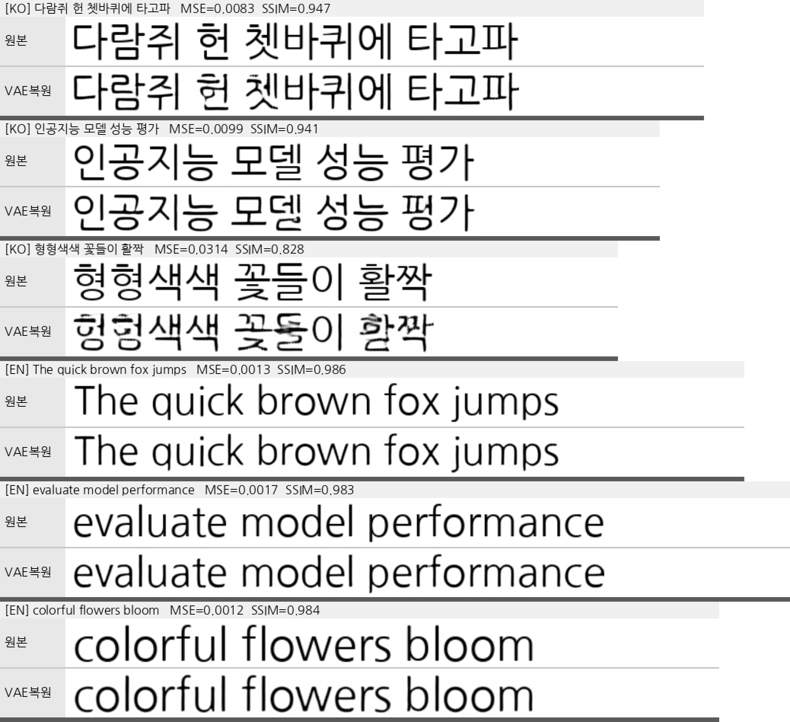
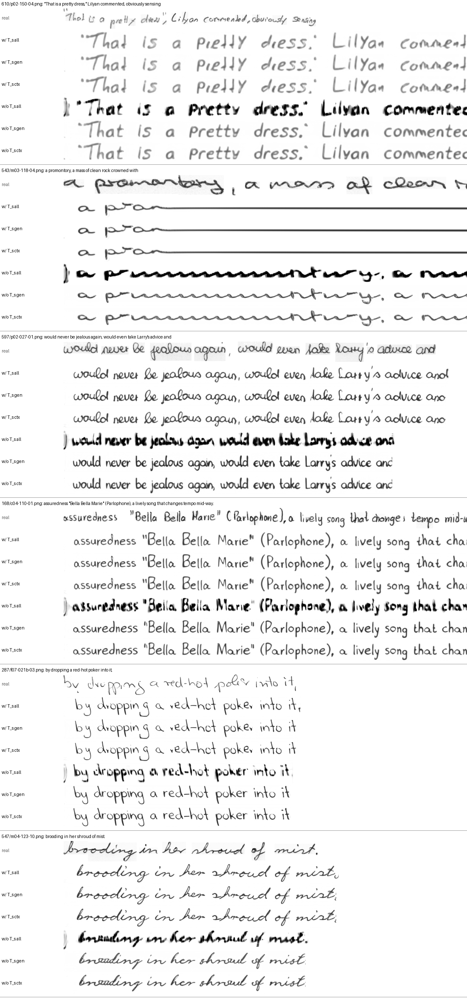
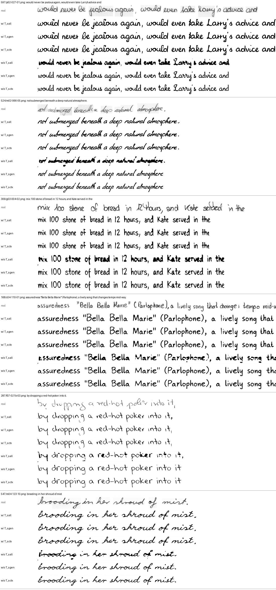
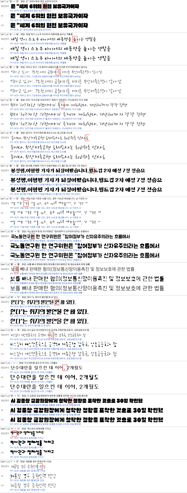

# 실험 로그 — 측정 결과 전문

README 에서 분리한 **측정 기록**이다. 코드에 반영된 결론만 보려면
[README 「결과 요약」](../README.md#결과-요약) 을 보면 된다. 여기엔 그 결론을 뒷받침하는
수치·표·재현 커맨드를 시간순으로 남긴다.

| 절 | 주제 | 한 줄 결론 |
|---|---|---|
| §1 | 초기 실험 (2026-06) | lr 5e-5 는 영어 init 에서 발산, 1e-5 안정. 한글 glyph 는 신규 학습이라 scale 필요 |
| §2 | echo 정량 비교 (2026-07) | v2 20k 가 fidelity 정점. 픽셀 지표는 정렬오차에 민감 → CER 로 재측정 |
| §3 | VAE 한글 수용성 (2026-07) | 한글 재구성 오차 = 영어의 ~12배. **이것이 한글 fidelity 하드상한** |
| §4 | VAE 한글 적응 (2026-07) | full(enc+dec) + HTR off(pure-L1) 가 최선, roundtrip MSE −83% |
| §5 | Eruku 재적응 (2026-07) | 단문강조 재적응으로 한글 CER 0.211 → 0.127, 단문 0.54 → 0.29 |
| §6 | VAE 강건성 | 실제 손글씨는 여백이 latent std 를 6~29배로 튀김 → ink bbox 크롭 |
| §7 | 종성 획 손실 (2026-08) | 겹받침 음절정확도가 홑받침보다 22%p 낮음 (진행 중) |
| §8 | 폰트 풀 156배 (2026-09) | seen 단문 중앙값 0.133 → **0.000**, 미노출 writer 는 상한 포화로 판정불가 |
| §9 | 코퍼스 35배 (2026-09) | 자연어 음절 32%→90%. seen 평균 0.084 → **0.069**, **폭주율 1.0% → 0.3%**(VAE 상한과 동률) |
| §10 | VAE 폰트 156배 (2026-09) | 측정 3중 오류로 결론 보류 → §11 |
| §11 | **§4 정정** (2026-09) | **HTR loss 를 껐던 게 잘못**. MSE 는 ㅇ↔ㅁ 혼동을 못 본다. HTR 0.3 이 CER 절반·자모교체 −52% |
| §12 | 생성 디코딩 방식 (2026-10) | SOG/EOG latent 는 학습 안 된 값 — 섞어 디코딩하면 얼룩·w/o T_s 붕괴(FID 64→31). **SOG 만 빼고 style+이미지+EOG 를 같이 디코딩(ctx)** 채택. EOG 포함 여부는 동등(words 만 FID 1~2 우세) |

---

## 1. 초기 실험 요약 (2026-06)

| 실험 | 결과 |
|---|---|
| 공식 pretrained, 영어 생성 | 완벽 (문장 전체, in-style, EOG 정상) → 모델/추론 코드 정상 |
| lr 5e-5 fine-tune (online split) | **발산** — mse 진동, 전 토큰 blank 붕괴 |
| lr 1e-5 fine-tune 4K step | 안정 (loss 1.61→1.04). 영어 능력 보존 + 한글 폰트 style 적응 시작. 한글 glyph 는 아직 미생성 (숫자 조각부터 emerge) |

핵심 인사이트:
- **lr 1e-5 권장.** 5e-5 는 영어 init 에서 발산.
- 한글 glyph 생성은 byte→glyph 매핑의 **신규 학습**이라 scale 필요 (논문 Phase2 = 10M 샘플). 4K step(8K 샘플)은 0.1% 미만 — 장기 학습 필수.
- style ref 가 학습 분포(합성 폰트) 밖이면 생성이 붕괴(OOD). fine-tune 이 진행될수록 한글 폰트 prefix 에 적응.
- 모델은 SOG 전까지 style 텍스트 나머지를 이어 그린 뒤(target 앞 echo) gen 텍스트를 그림 — 뷰어는 입력 style 폭만큼 잘라 보여주므로 echo 가 생성부 앞에 보일 수 있음.
- 렌더가 깨지는 폰트 3종(NMFClassic, GangwonEduSaeeum, KCCPakKyongni)은 assets 에서 제거됨.

## 2. 모델 성능 비교 — echo 정량 (2026-07)

측정 방식: **echo(style_text == gen_text)** — 텍스트 T 를 폰트로 깨끗이 렌더한 GT 를 style 로 주고 같은 T 를
생성, GT 와 비교. n=100 다양 길이(1~15어절), cfg=1.0, seen 폰트. 스크립트 `eval/echo_metrics.py`.
(↓ 낮을수록 좋음: MSE·LPIPS·FID / ↑ 높을수록: SSIM. **굵게 = 열 최고**)

> **표의 `v2` 가 뭔지** — **데이터 파이프라인 버전**이다. VAE 버전도, `assets/fonts_korean_v2`
> 디렉토리와도 **무관하다**. `data.legacy_transform` 한 플래그를 가리킨다:
> `구 transform` = `legacy_transform: true`(원본 composite 증강 — 합쳐 렌더 후 경계분할),
> `v2` = `legacy_transform: false`(현행 정책 — 흰배경·무휨 렌더).
>
> 실체는 `finetune_runs/korean_en2ko_fixed` 다. 설정의 요점만:
>
> | 항목 | 값 | 뜻 |
> |---|---|---|
> | `resume` | `null` | 이어받기 없음 |
> | `eruku_pretrained` | `model_zoo/eruku_pretrained/000073688.pth` | **영어 pretrained 에서 바로 시작** |
> | `vae_checkpoint` | `blowing-up-groundhogs/emuru_vae` | **원본 VAE 동결. 한글 적응 전이다** |
> | `lr` / `max_steps` | 5e-5 / 20000 | |
>
> 즉 `v2` 는 **한글 VAE 적응(§4) 이전** 단계다. 여기서 §3 의 상한을 만나 s11000 에서 정체했고,
> 그 지점에서 `--reset-vae` 로 한글 VAE 를 붙인 것이 `eruku_readapt_fullvae`(§4) → §5 로 이어진다.
> 계보 전체는 §13 의 표 참조.

### 한글 (echo, n=100)

| 모델 (step) | MSE↓ | SSIM↑ | LPIPS↓ | FID↓ |
|---|---|---|---|---|
| 구 transform 20k | 0.195 | 0.364 | 0.459 | 75.6 |
| **v2 20k** | **0.187** | **0.377** | **0.450** | **70.7** |
| v2 24k | 0.207 | 0.344 | 0.464 | 81.7 |
| v2 27k | 0.194 | 0.370 | 0.462 | 76.6 |
| v2 30k | 0.208 | 0.336 | 0.450 | 75.0 |

### 영어 (echo, n=100, pretrained 포함)

| 모델 | MSE↓ | SSIM↑ | LPIPS↓ | FID↓ |
|---|---|---|---|---|
| pretrained (영어 원조) | **0.145** | **0.503** | 0.421 | 84.8 |
| 구 transform 20k | 0.168 | 0.455 | 0.367 | 54.4 |
| **v2 20k** | 0.162 | 0.468 | 0.324 | **52.5** |
| v2 30k | 0.170 | 0.453 | **0.318** | 57.3 |

### 정성 관찰 (montage/CER)

- **완성도(문장 끝맺음)**: pretrained 는 긴 표준영어 완전완성(16~17어절)에 강함. v2 는 긴 **한글**을 30k 에서
  4/4 완성(20k 은 반복붕괴)했으나 긴 **영어**는 아직 반복붕괴 → 학습분포상 긴영어 부족(전체의 ~10%).
- **출력 스타일**: v2 는 gen 을 **흰배경·곧은글자(무휨)** 로 생성(새 데이터 정책). 구 모델은 휨/배경 잔존.
- **트레이드오프**: 한글·폰트 스타일적응(v2) ↔ 긴 영어 완성(pretrained). v2 20k 가 파인튜닝 중 fidelity 정점,
  30k 는 긴한글 완성↑ 이나 fidelity 소폭↓(과적합).
- **주의(지표 해석)**: 픽셀(MSE/SSIM)은 글자 위치/간격 정렬오차에 민감해 절대값 과소평가·언어간 비교 부적절;
  FID(n=100)는 노이즈 큼. **OCR 기반 CER**(`eval/cer.py`, 정렬무관·언어공정·완성도 반영)로 정밀 재측정 진행 중.
- 도구: `infer/show.py`(그리드), `infer/matrix.py`(스타일×텍스트 매트릭스), `infer/echo_compare.py`(모델 나란히),
  `eval/echo_metrics.py`/`eval/cer.py`(정량).

## 3. 한글 학습의 하드 상한 — VAE 한글 수용성 (2026-07)

en2ko fine-tune(영어 pretrained→한글)에서 한글 CER 이 step **~11k 부근에서 plateau** 하고, 그 이상 학습하면
val loss 만 오르고(과적합) 영어가 소폭 퇴보한다. 아무리 더 돌려도 한글 fidelity 가 어느 선 위로 안 올라간다.
원인은 학습 부족이 아니라 **동결 VAE 의 한글 재구성 한계**다.

모델은 픽셀이 아니라 **VAE latent** 만 조건·타깃으로 쓴다(latent 1열 = 8차원). 따라서 `decode(encode(x))` 가
못 담는 디테일은 모델이 애초에 조건으로 볼 수도, 타깃으로 배울 수도 없다 = **한글 학습의 하드 상한**.

같은 폰트(NanumGothic)로 한글/영어를 VAE 왕복(encode→decode)시킨 재구성 오차 — 근거 스크립트 `docs/_vae_capacity.py`:

| | 평균 MSE↓ | 평균 SSIM↑ | 최악 사례 |
|---|---|---|---|
| **한글** | **0.0165** | **0.906** | "형형색색 꽃들이 활짝" → SSIM **0.828** (밀집 음절 뭉개짐) |
| **영어** | 0.0014 | 0.984 | 3개 모두 SSIM ~0.98 (거의 완벽 복원) |

한글 재구성 오차가 영어의 **약 12배**. 특히 획이 밀집한 음절(형·꽃·활짝)에서 심하게 흐려진다 —
초·중·종성이 한 칸에 2D로 쌓이는 한글이, latent 폭당 8차원 표현에서 영어(선형 단순 글자)보다 불리하기 때문.



*각 예: 원본 vs VAE복원. 영어는 원본과 거의 동일, 한글은 밀집 음절일수록 뭉개짐(=모델이 볼 수 있는 정보의 상한).*

**함의 — 한글 fidelity 를 더 올리려면 학습이 아니라 VAE 를 손대야 한다:**
- (a) **VAE decoder 파인튜닝** — encoder/latent 고정(T5 인터페이스 유지) → 출력 렌더 충실도만 개선. **저위험**.
- (b) **입력 해상도↑** (h=64→96, latent 세로 8→12로 용량↑). 단 `query_emb`/`t5_to_vae` 재init 필요.
- (c) **한글로 VAE encoder+T5 공동 재학습** — conditioning 정보 상한 자체를 올림. **고위험**(pretrained 강점 재학습).

## 4. VAE 한글 적응 실험 (2026-07) — ~~full(enc+dec) + HTR off 가 최선~~

> ⚠️ **이 절의 「HTR off」 결론은 2026-09-09 에 반증됐다 → [§11](#11-4-정정--htr-loss-를-껐던-결정이-잘못됐다-2026-09-09).**
> 판정 지표가 roundtrip MSE 였는데 **MSE 는 ㅇ↔ㅁ 같은 자모 혼동을 못 본다.** 같은 조건에서
> HTR 0.3 은 MSE 를 62~69% 악화시키지만 **CER 을 절반으로, 자모 교체를 39~52% 줄인다.**
> 아래 MSE 표는 그대로 유효하나, 그로부터 도출한 레시피(`--htr-weight 0`)는 쓰지 말 것.

위 (a)/(c) 를 실제로 학습해 비교. 파이프라인: 한글 HTR finetune(`train/aux_htr.py`) → VAE finetune(`train/vae_korean.py`) →
교체 검증(`infer/show.py`/`eval/cer.py --vae-checkpoint`). clean-bw roundtrip MSE(고정 probe, `experiments/vae_recon.py`):

| VAE | 일반 한글 | 극단 폰트 | 영어 |
|---|---|---|---|
| 원본 emuru | 0.0188 | 0.0197 | 0.0020 |
| decoder-only + HTR | 0.0120 (−36%) | — | 0.0032 |
| **full + HTR(0.3)** | 0.0089 (−53%) | 0.0183 | 0.0037 ⚠️영어 **악화** |
| **full + HTR off (pure-L1)** ⭐ | **0.0031 (−83%)** | **0.0128** | **0.0012** |

**핵심 발견 — VAE 한글 적응은 `--train-part full --htr-weight 0`(HTR 끔)이 결과가 제일 좋다:**
- HTR(OCR 가독성) loss 는 **MSE 를 최적화하지 않는다** — "정확한 글자로 읽히게"(프로토타입) 밀어서 그 폰트의 정확한 획에서 멀어짐 → 픽셀 MSE↑. 텍스트는 흑백 고대비라 **L1 만으로 이미 획이 또렷**해서 HTR 가독성 기여가 중복이고, 프로토타입 편향·1채널 용량 경쟁 비용만 남는다.
- 특히 **한글 HTR 은 영어를 악화**시킴(공유 decoder 를 한글 획으로 편향, 0.0020→0.0037). pure-L1 은 스크립트 중립이라 영어도 개선.
- pure-L1 이라도 **흐릿해지지 않음** — 극단 폰트(초굵은/붓글씨)에서도 획을 선명히 살림(고대비 → L1 이 엣지 보존).
- 원본 Emuru 가 HTR 로 이득 본 건 배경노이즈 **디노이징** 태스크 + 영어HTR·영어데이터 정합 + 10만폰트 맥락이라, 깨끗한 한글 폰트 복원인 우리와 상황이 다름.

권장 레시피(VAE finetune): `--train-part full --htr-weight 0 --kl-weight 1e-6`, warm-start(decoder-only→full 순), 지표는 held-out roundtrip MSE.
**주의**: `train-part full` 은 latent 공간이 바뀌므로 Eruku 를 **기존 한글 ckpt 에서 resume + `train/core.py --reset-vae`**(ckpt 의 옛 vae.\* strip) 로 재적응해야 한다. decoder-only 는 latent 불변이라 재학습 없이 `--vae-checkpoint` 교체만으로 사용 가능.
한계: held-out 극단 폰트는 여전히 높음(폰트 다양성 부족, 원본 10만 vs 우리 99). 증강·균일빈도로는 오히려 악화 → 폰트 수집이 유일한 진짜 레버.

### log_var(학습형 관측 노이즈 가중) — 논문 아닌 원본 *코드* 관례, 우리 세팅선 무익 → [`docs/VAE_LOGVAR.md`](VAE_LOGVAR.md)

원본 `models/autoencoder_loss.py` 의 `nll/exp(log_var)+log_var` 항(LDM/CompVis Kendall식 학습형 recon 가중, **논문엔 없음**)을 `--logvar-weighting` 로 복원해 통제실험. 원본 emuru VAE 에서 동일 seed·데이터·예산(full·pure-L1·15000step)으로 **log_var 유무만** 다르게(`run_logvar_clean.sh`):

| VAE (s15000) | 일반 한글 | 극단 폰트 | 영어 |
|---|---|---|---|
| 원본 emuru | 0.0188 | 0.0197 | 0.0020 |
| control (logvar off) | **0.0038** | **0.0131** | **0.0014** |
| logvar on | 0.0037 (동률) | 0.0138 (+5%) | 0.0015 (+7%) |

**결론 — log_var 무익, 기본 off**: 그 수학적 실익(관측 노이즈 MLE 자기보정·grad 스케일 정규화·다중 loss 항 밸런싱)은 모두 "여러 항을 섞고 KL 이 유의미할 때" 발동하는데, 우리는 **KL=1e-6(무시수준)·단일 L1 항·Adam(이미 grad 정규화)** 이라 발동 여지가 없다. 최종 `lv=-1.481` 로 이론 종착점 `s*=log L≈-3.5` 에 15k step 내 수렴도 못 함(inert). ko 동률·hard/en 미세 열화로 실측 확인. → `--logvar-weighting` 플래그만 재현용 보존, 기본 off.

### loss 항 ablation (pyramid / HTR / 예산) — 결론: **pure-L1 이 최선, 예산이 진짜 레버**

`--pyramid-weight`(Laplacian band-pass = 고주파 대역 가중, 획 엣지를 더 세게 감독하려는 시도) 와
HTR 가중치를 조합해 **같은 seed·데이터**로 통제 비교. 지표는 학습 중 held-out **폰트** val
roundtrip(각 런 `vae_val.csv` 마지막 행, `--val-font-frac 0.1`, seed 42):

| 런 (step) | train-part | loss 항 | 한글 MSE↓ / SSIM↑ | 영어 MSE↓ |
|---|---|---|---|---|
| `vae_orig_dec_pureL1` (15k) | dec | L1 | 0.00972 / 0.9514 | 0.00205 |
| `vae_orig_dec_pyr` (15k) | dec | L1+pyr | 0.00997 / 0.9382 | 0.00191 |
| `vae_orig_pureL1` (15k) | full | L1 | 0.00713 / 0.9597 | 0.00196 |
| `vae_orig_pureL1_logvar` (15k) | full | L1+logvar | 0.00828 / 0.9539 | 0.00189 |
| `vae_orig_full_L1_htr01` (15k) | full | L1+htr 0.1 | 0.01048 / 0.9364 | 0.00266 |
| `vae_orig_full_pyr_htr01` (15k) | full | L1+pyr+htr 0.1 | 0.00894 / 0.9438 | 0.00198 |
| `vae_orig_full_pyr` (30k) | full | L1+pyr | 0.00645 / 0.9591 | **0.00143** |
| `vae_orig_full_pyr` (45k, 30k에서 resume 연장) | full | L1+pyr | 0.00711 / 0.9558 | 0.00140 |
| **`vae_korean_full_mse` (28k)** ⭐ 릴리즈 | full | L1 (디렉토리명만 mse) | **0.00656 / 0.9647** | 0.00161 |
| `vae_orig_full_htr03_30k` (30k, 완료) | full | L1+htr 0.3 | 0.01156 / 0.9263 | 0.00323 |

- **pyramid 는 이득 없음** — 같은 15k 예산에서 pure-L1 과 사실상 동률이거나 약간 나쁨
  (dec 0.00997 vs 0.00972, SSIM 은 −1.3%p). 텍스트는 이미 흑백 고대비라 L1 자체가 엣지를
  보존하므로 고주파 가중이 **중복**이다. 유일한 쓸모: htr 을 켠 조합에서 그 해악을 일부 상쇄
  (0.01048 → 0.00894) — 즉 "htr 로 흐려진 걸 pyr 로 되돌리는" 구조라, htr 을 끄면 필요 없다.
- **htr 은 예산을 30k 로 늘려도 열위**(완료 s30000 에서 0.01156, 영어도 0.0032) → 위 「HTR off」 결론 재확인.
- **예산은 듣지만 30k 부근에서 포화**: 동일 pure-L1 계열에서 15k 0.00713 → 28~30k 0.0065 로 내려간 뒤,
  그 이상은 더 안 내려간다.
- ⚠️ **resume 로 예산을 늘리면 오히려 퇴보할 수 있다.** `full_pyr` 을 s30000 에서 45k 까지 이어 돌린 결과
  0.00645 → s36000 0.00736 → s45000 0.00711 로, 15k step 을 더 쓰고도 **자기 최적점을 회복하지 못했다**.
  resume 는 Adam 상태·lr 스케줄을 새로 시작하므로 좋은 지점에서 밀려난다. 연장할 거면 처음부터 긴 예산으로
  한 번에 돌리고, 중간 최적 ckpt 는 반드시 보존할 것.
- 30k 예산에서 `full_pyr` 과 `full_mse` 는 한글 동급(0.00645 vs 0.00656)이고 SSIM 은 full_mse 가
  낫다 → **릴리즈는 `full_mse` s28000 유지**(교체 시 Eruku 재적응이 다시 필요한데 이득이 없음).

## 5. Eruku 재적응 (2026-07) — full_mse VAE + 단문강조로 단문 병목 해소

full_mse VAE 는 재구성 상한을 크게 올렸지만(roundtrip MSE −83%), 그 상한이 **실제 생성으로 발현되려면 T5 를
새 latent 공간에 재적응**시켜야 한다(full 은 latent 이동 → Eruku resume 필수). 진단 결과 생성 병목은 VAE decode 가
아니라 **T5 의 단문 latent 예측**이었다(한글 단문 CER ~0.5, 장문은 ~0.05). 이를 겨냥해 단문 비중을 높인 재적응을 수행:

```
# eruku_readapt_fullvae(full_mse VAE 내장) s15000 에서 resume, 단문강조
CUDA_VISIBLE_DEVICES=2 .venv/bin/python train/korean_from_en.py \
  --resume finetune_runs/eruku_readapt_fullvae/checkpoint_step_015000.pth \
  --out finetune_runs/eruku_short_fullmse \
  --gen-words 1 12 --style-words 1 8 --max-img-len 4096 \
  --extra-steps 15000 --batch-size 4 --grad-accum 8 --lr 5e-5 \
  --english-frac 0.15 --num-workers 16 --save-every 2000 --val-every 2000
```

**평가 = `eval/htr_cer.py`** (한글 HTR 리더, 렌더바닥 CER ~0.00 — easyocr 은 한글 GT 조차 0.236 로 saturated 해 못 씀).
n=100, cfg=1.0, coherent:

| 버킷 | decoder-only | full_mse (재적응 전) | **full_mse + 단문재적응 s30000** |
|---|---|---|---|
| 한글 **전체** | 0.203 | 0.211 | **0.127 (−40%)** |
| 한글 **단문(1~3)** | 0.497 | 0.540 | **0.286 (거의 절반)** |
| 한글 중문(4~8) | — | — | 0.049 |
| 한글 장문(9~15) | — | — | 0.059 |
| 영어 전체 | 0.084 | 0.056 | **0.045 (회귀 없음)** |

**핵심 결론**:
- 생성 품질 = **VAE(상한) × T5(상한 근접도)**. full_mse VAE 로 상한을 올린 뒤 단문강조 재적응이 T5 병목을 잡아, 단문 한글 CER 을 **0.54→0.29 로 절반** 냈다. 영어도 회귀 없이 개선.
- **best ckpt = `finetune_runs/eruku_short_fullmse/checkpoint_step_030000.pth`**. val_mse 는 s20000(0.100)이 s30000(0.113)보다 낮지만, 실제 생성 CER 은 s30000 이 우수(전체 0.127 vs 0.138, 단문 0.286 vs 0.317) — **val_mse 노이즈는 생성품질과 무관**하므로 CER 로 고를 것.
- 복잡획(밝·붉·닭·삶·값·짧…) 단문 생성 전후 비교: `finetune_runs/eruku_short_fullmse/_eval/gencmp_{ko_complex_short,ko_short,ko_long}.png` (재적응 전 s15000 vs 후 s30000, 동일 VAE — 차이는 순수 T5 개선분). 스크립트 `experiments/gen_compare.py`.

## 6. VAE 강건성 & 실제 손글씨 미러링 → [`VAE_ROBUSTNESS.md`](VAE_ROBUSTNESS.md)

폰트-렌더 입력은 잘 되지만 **실제 스캔 손글씨 style** 에서 드러난 두 별개 결함을 정리한 문서:
- **① 프로토타입 붕괴**(decoder/복원): VAE 가 입력 잉크농도를 무시하고 항상 crisp 순검정으로 snap →
  headline MSE 이득의 일부가 "crisp 타깃 snap" 이고 실제 손글씨 복원은 악화. 수정=농담보존 타깃(재학습 필요).
- **② 실제 손글씨 runaway**(encoder/조건): style 이미지 **여백** 이 latent std 를 폰트의 6~29배로 튀겨 T5 OOD →
  runaway/blank. **수정=밀도 기반 ink bbox 크롭**(재학습 불필요, `experiments/mirror_compare.py`). 근본은 학습이
  style 을 항상 프레임 꽉 채운 상태로만 본 갭.

## 7. 종성(받침) 획 손실 — 특히 **겹받침** (2026-08, 진행 중)

받침 있는 음절에서 획이 뭉개지는 현상을 정량화했다. 상세·중간 실험은
[`docs/JONGSEONG_STROKE_LOSS.md`](JONGSEONG_STROKE_LOSS.md), 측정 스크립트는
`experiments/jong_stroke_loss.py`(VAE 픽셀 정밀) / `jong_gen_loss.py`(생성, 자모 단위).

**① VAE 재구성** (roundtrip 은 입력과 픽셀 정렬 → 음절 창을 잘라 정확히 측정. 폰트 16종 × 120라인,
n=23,039 음절. `missing` = GT 잉크 중 복원에서 사라진 비율):

| 종성 유형 | n | missing↓ | IoU↑ | 받침자리(아래 40%) missing↓ |
|---|---|---|---|---|
| 없음 | 3,312 | 0.054 | 0.899 | 0.048 |
| 홑받침 | 17,279 | 0.077 | 0.863 | 0.081 |
| 쌍받침 ㄲㅆ | 1,280 | 0.098 | 0.835 | **0.131** |
| 겹받침 ㄳㄵㄺ… | 1,168 | 0.100 | 0.828 | 0.115 |

종성 없음 대비 홑 +43% / 쌍 +81% / 겹 +85%. 받침 자리로 좁히면 격차가 **2.7배**로 벌어져,
손실이 음절 전체가 아니라 **받침 위치에 집중**돼 있다. `ink_keep≈1.0` 인데 missing≈extra 이므로
획이 증발한다기보다 **자리가 밀린다**. 최악 종성: ㅊ 0.129 > ㅀ 0.122 > ㄾ 0.121 > ㄶ 0.119 > ㅆ 0.100.
원본 영어 VAE 대비로는 이미 2.4~2.7배 개선된 상태(겹 0.265→0.100)지만 **유형 간 격차는 그대로 남았다**.
held-out 폰트가 오히려 약간 더 좋아 폰트 과적합은 아니다.

**② 생성 경로** (HTR 리더로 읽고 음절 정렬 후 자모 분해. 종성 유형 균등 텍스트, 유형별 450음절):

| 종성 유형 | 음절정확도↑ (GT렌더 / VAE복원 / **생성**) | 종성삭제율↓ | 종성오치환↓ |
|---|---|---|---|
| 없음 | 0.947 / 0.924 / **0.729** | — | — |
| 홑받침 | 0.976 / 0.900 / **0.711** | 0.000 / 0.007 / **0.042** | 0.011 / 0.053 / **0.140** |
| 쌍받침 ㄲㅆ | 0.969 / 0.913 / **0.720** | 0.002 / 0.004 / **0.056** | 0.018 / 0.044 / **0.149** |
| 겹받침 ㄳㄵ… | 0.956 / 0.844 / **0.493** | 0.000 / 0.013 / **0.058** | 0.036 / 0.118 / **0.404** |

- 진짜 취약한 건 ㄲ·ㅆ 가 아니라 **겹받침**이다. 쌍받침 음절정확도(0.720)는 홑받침(0.711)과 동급인데,
  **겹받침만 0.493 으로 22~24%p 낮다.**
- 지배적 실패 모드는 삭제(5.8%)가 아니라 **오치환 40.4%**(홑받침의 2.9배) — 두 자음 중 하나를 잃는 형태.
- 초성·중성 오류는 유형 무관하게 13~19%로 평탄 → 추가 손실은 **종성에만 국한**.
- **책임 분해**(겹받침 오치환): 리더바닥 3.6% → VAE 11.8% → 생성 40.4%. VAE 가 8%p, **T5 가 29%p**.
  VAE 재구성이 하드상한인 건 맞지만 겹받침에 한해선 **손실의 3/4 이 생성 단계**에서 생긴다
  → VAE 만 더 키워도 이 문제는 대부분 남는다.

> 측정 조건 주의: ② 는 종성 유형 표본을 맞추려고 **무작위 음절 나열**(OOD)을 쓴 통제 비교다.
> 절대 수준은 실제 문장보다 나쁘며, 읽어야 할 것은 **유형 간 상대 차이**다.


## 8. 폰트 풀 83종 → 12,951종 (2026-09-02) — seen −37%, 미노출 writer 무승부

§4 의 결론("폰트 다양성 부족이 진짜 레버, 증강·균일빈도로는 오히려 악화")을 실제로 집행했다.
온글잎 배포가능 폰트 11,989종을 **전량** 수집해 학습 풀을 **83종 → 12,951종(156배)** 으로 키우고,
§5 의 best 레시피에서 **폰트 디렉토리만** 바꿔 재적응했다.

### 수집·게이트

| | 결과 |
|---|---|
| 온글잎 | 배포가능 11,989 전량 조회 → **11,946종 확보** (신규 10,951 + 기존 995, 글리프해시 중복 1,032 제거, 실패 6). 15GB |
| 눈누 | **소진 확정** — sitemap 1,172 페이지 전부 처리(OK 896 / 기보유 136 / 중복 79 / 저커버 40 / webfont없음 16 / DL실패 5). 재시도해도 5건은 jsdelivr URL 이 죽어 영구 실패 |
| 게이트 (`tools/font_pool_audit.py`) | 온글잎 11,946 → **OK 11,940 · PARTIAL 2 · REJECT 4**(기하 이상 글리프). 실제 사람 손글씨라 품질이 균일하다 |
| 최종 풀 | `assets/fonts_korean_v3/train/` **12,951종** = v2/train 83 + 눈누 943 + 온글잎 11,940 − 교집합 훼손 15종 (심볼릭 링크, git 제외) |

**교집합 방어가 핵심이다.** `charset_rule: intersection` 이라 폰트 한 종이 학습 음절 풀 전체를 끌어내린다.
게이트 통과 직후 교집합은 한글 2,345자로 5자 줄어 있었고, 원인 폰트 15종(`Bohyun`·`OwnglyphMoogungChae`·
`770Balsa`·`116Watermelon` 등)을 빼서 **2,350자 = 기존과 동일**로 복구했다. 최종 손실은 `$ * { | }` 5자뿐이고
그중 샘플러가 실제로 쓰는 건 `SPECIALS` 의 `$` `*` 둘이다(`$`·`*`·`|` 는 온글잎 9,516종의 공통 결손이라 복구 불가).
구두점 `.,!?…:;` 과 괄호쌍은 전부 살아 있다.

### 학습

`train/korean_from_en.py`, §5 best ckpt(`eruku_short_fullmse` s30000)에서 resume, **폰트 디렉토리만 변경**.
나머지 하이퍼파라미터 전부 동결(batch 4 × accum 8, lr 5e-5, style [1,8] / gen [1,12], max_img_len 4096,
english_frac 0.15). `--val-fonts-dir assets/fonts_korean_v2/test` 로 val 폰트를 **고정**했다 — 지정하지 않으면
풀이 바뀔 때 `split_train_fonts` 가 다른 폰트를 뽑아 val loss 가 런 간 비교 불가가 된다.

```
CUDA_VISIBLE_DEVICES=2 .venv/bin/python train/korean_from_en.py \
  --resume finetune_runs/eruku_short_fullmse/checkpoint_step_030000.pth \
  --out finetune_runs/eruku_fontmax \
  --korean-fonts-dir assets/fonts_korean_v3/train \
  --val-fonts-dir assets/fonts_korean_v2/test \
  --style-words 1 8 --gen-words 1 12 --max-img-len 4096 --extra-steps 15000 \
  --batch-size 4 --grad-accum 8 --lr 5e-5 --english-frac 0.15 \
  --num-workers 16 --save-every 2000 --log-every 20 --val-every 2000 --save-samples 16
```

s30000 → s45000, **421.7분(7.0시간)**, 0.61 it/s, truncation drop 0.85%.
train loss 는 resume 직후 **0.115 로 튀었다가**(기준선 종료값 0.048 의 2.4배 — 12,951종이 모델에게 진짜
새 분포라는 뜻) 0.061 까지 내려왔다. 기동 시간은 `fonts_sizes.json` 캐시(D7 수정) 덕에 12,951종에서도 14.7초다.

### 결과 (`eval/htr_cer.py --n 300 --coherent`, cfg=1.0, 고정 평가셋 `corpus/eval_lines_ko.txt`)

> ⚠️ **평균 CER 단독으로 판정하면 안 된다.** CER 은 위로 열려 있어(runaway 는 3~5까지) 표본 몇 건이
> 평균을 지배한다. 실측: **같은 모델·같은 텍스트**를 두 번 돌렸더니 기준선 seen 단문이
> **0.280 과 1.076** 으로 나왔다(생성이 run-to-run 재현되지 않는다 — `eval.sh:53`).
> 그래서 `eval/htr_cer.py` 가 **중앙값**과 **폭주율**(CER>1 = 목표보다 긴 출력 비율)을 함께 낸다.
> 판정은 중앙값·폭주율로 하고 평균은 참고만 한다.

**한글 seen (`fonts_korean_v2/train` 83종)**

| | 평균CER | **중앙값** | **폭주율** |
|---|---|---|---|
| VAE 상한 (GT→VAE 왕복) | 0.031 | 0.000 | 0.3% |
| 기준선 s30000 — 전체 | 0.120 | 0.026 | 1.3% |
| **fontmax s45000 — 전체** | **0.084** | **0.000** | **1.0%** |
| 기준선 — 단문(1~3) | 0.280 | 0.133 | 4.2% |
| **fontmax — 단문** | **0.172** | **0.000** | **3.2%** |

**한글 held-out (`fonts_korean_v2/test` 16종, 양쪽 모두 미노출)**

| | 평균CER | **중앙값** | **폭주율** |
|---|---|---|---|
| VAE 상한 | 0.084 | 0.000 | 0.7% |
| **기준선 s30000 — 전체** | **0.090** | **0.000** | 0.7% |
| fontmax s45000 — 전체 | 0.189 | 0.028 | 0.7% |
| 기준선 — 중문 / 장문 (중앙값) | — | **0.000 / 0.000** | 0% |
| fontmax — 중문 / 장문 (중앙값) | — | 0.033 / 0.051 | 0% |

영어(n=300): 기준선 0.034 / fontmax 0.032, 중앙값 양쪽 0.000 → **동률**.

**결론**:
- **seen 에서는 fontmax 가 세 통계 모두 우세**하다. 특히 단문 중앙값 **0.133 → 0.000** — 짧은 텍스트의
  절반 이상이 완벽해졌다는 뜻으로, 평균 개선(0.280→0.172)보다 이쪽이 훨씬 견고한 신호다.
- **held-out 에서는 fontmax 가 근소하게 나쁘다**(중앙값 0.000 → 0.028). 폭주율은 양쪽 동일(0.7%)이라
  **runaway 문제가 아니라 평상시 품질이 조금 떨어진 것**이다.
- 다만 **held-out 은 애초에 헤드룸이 없었다.** 기준선이 이미 VAE 상한에 붙어 있다(0.090 vs 상한 0.084,
  gap 0.006). 반면 seen 은 gap 0.089 였고 fontmax 가 그중 **40%를 메웠다**(0.089 → 0.053).
  즉 "폰트 다양성이 일반화에 실패했다"기보다 **그 held-out 세트에서는 잴 여지가 없었다**가 정확하다.
  writer 일반화를 제대로 재려면 상한에서 먼 held-out 세트가 필요하다.
- **best ckpt = `finetune_runs/eruku_fontmax/checkpoint_last.pth`(s45000)**. val_mse 는 s40000/s44000 이
  더 낮지만 CER 은 s45000 이 최고다 — §5 의 "val_mse 로 고르지 말 것" 재확인.
- 학습 도중(s38000·s40000)에는 held-out 단문에서 runaway 구간을 지난다. 중간 ckpt 로 판단하면 안 된다.

### ⚠️ 귀속 한계 — 통제군을 돌리지 않았다

기존 83폰트로 같은 15k step 을 더 돌린 통제군이 없으므로, seen 개선분에서 **"폰트가 늘어서"와
"step 을 15k 더 돌려서"를 분리할 수 없다.** 미노출 writer 가 무승부라는 사실은 오히려 후자 쪽 설명과
정합적이다 — 폰트 다양성이 일반화를 끌어올렸다면 held-out 이 같이 올라야 했다.
"writer 다양성 확보"를 주장하려면 통제군(약 7시간) 이 필요하다.

### 부수 발견

- **기존 버그**: `make_english_dataset` 이 `exclude_fonts` 가 비면 안 될 때 `fonts_dir` 를 리스트로 덮어써
  `Path()` 에서 `TypeError` 로 죽었다. `data.exclude_fonts` 기본값이 `[UlsanJunggu]` 라 **`english_frac > 0`
  인 모든 학습이 기동 즉시 실패**하는 상태였다(커밋 5481f3f 이후). 한글 `make_dataset` 과 같이
  charset 디렉토리와 폰트 리스트를 분리해 수정.
- **환경 파손**: `.venv` 의 opencv 패키지가 껍데기만 남아 있었다(`__init__.py`·바이너리 없음). `uv.lock` 과
  같은 4.13.0.92 로 재설치.
- **`fonts_sizes.json` 캐시 신설** (`tools/font_sizes.py`, D7) — 없으면 `make_renderers` 가 폰트마다
  순차 캘리브레이션을 DataLoader 워커마다 반복한다. 12,951종에선 필수다.


## 9. 코퍼스 941줄 → 50,941줄 (2026-09-04) — 폭주가 사라졌다

§8 의 오차 분해에서 남은 몫의 68%가 T5 였고, D10/D1 진단은 T5 가 보는 **텍스트 기반이 빈약**함을
가리켰다. 실측: `korean_lines.txt` 는 22,996줄이지만 고유 941줄뿐이고, 자주 쓰는 2,350 음절 중
**754자(32.1%)만 자연어 문맥에 등장**했다. 나머지 68%는 오직 `rand` 토큰(무작위 음절 나열, 전체의 15%)
으로만 나온다. 폰트는 156배가 됐는데 **그 폰트로 렌더할 텍스트가 그대로**였던 셈이다.

### 처리

1. **중복 제거** — 22,996 → 941줄 (D10). 학습은 bit-identical(`build_pools` 가 `set` 으로 접는다).
2. **평가 텍스트 분리·고정** — `build_texts` 가 학습 코퍼스에서 뽑고 있어 코퍼스를 건드릴 때마다
   CER 비교가 끊겼다. 941줄 스냅샷을 `assets/corpus/eval_lines_ko.txt` 로 고정
   (`eval/echo_metrics.py:EVAL_LINES_KO`). **이제 코퍼스를 키워도 지표가 살아남는다.**
3. **확장** — `tools/fetch_corpus.py`, 한국어 위키백과(CC BY-SA, HF `heegyu/kowiki-sentences`).
   커버리지 패스(새 음절을 들여오는 줄만, 1,272줄로 2,113자 도달) + 물량 패스.

| | 확장 전 | 확장 후 |
|---|---|---|
| 라인 | 941 | **50,941** |
| ko 어절 풀 | 5,196 | **184,529** (35×) |
| **자연어 문맥 음절** | 754 / 2,345 (32.1%) | **2,113 / 2,345 (90.1%)** |
| 학습 알파벳 | 2,512 | **2,512** (불변 — ckpt 핀 유지) |

### 학습 — 폰트 효과와 분리된 A/B

`eruku_corpusmax` 는 `eruku_fontmax` 와 **같은 출발점(s30000)·같은 15k step·같은 12,951폰트·같은
하이퍼파라미터**로 돌리고 **코퍼스만** 바꿨다. 426.7분.

### 결과 (n=300, coherent, cfg=1.0, 고정 평가셋)

**한글 seen (83종)**

| | 평균 | **중앙값** | **폭주율** |
|---|---|---|---|
| VAE 상한 | 0.031 | 0.000 | 0.3% |
| 기준선 s30000 | 0.120 | 0.026 | 1.3% |
| fontmax s45000 | 0.084 | 0.000 | 1.0% |
| **corpusmax s45000** ⭐ | **0.069** | **0.000** | **0.3%** |
| ↳ 단문(1~3) | 0.142 (fontmax 0.172, 기준선 0.280) | 0.000 | **1.1%** (3.2% / 4.2%) |

**폭주율이 모든 세트에서 최저다** — 이게 코퍼스 확장의 가장 뚜렷한 효과다:

| 폭주율(CER>1) | 기준선 | fontmax | **corpusmax** |
|---|---|---|---|
| seen | 1.3% | 1.0% | **0.3%** (= VAE 상한과 동률) |
| held-out (v2/test) | 0.7% | 0.7% | **0.3%** |
| 실제 사람 필적 4종 | 2.3% | 1.7% | **0.7%** |

폭주 = "생성이 안 멈춤"(EOG 실패)이다. 자연어 문장을 35배 늘리자 **줄을 끝내는 법**을 배운 것으로 보인다.
seen 에서 corpusmax 의 폭주율은 VAE 상한(0.3%)과 같아, 이 실패 모드는 사실상 소진됐다.

영어(n=300): 기준선 0.034 / fontmax 0.032 / corpusmax 0.036 — 중앙값 전부 0.000, **동률**.

### ⚠️ 미노출 폰트 두 세트는 모두 판정 불가였다

| held-out 세트 | 문제 |
|---|---|
| `fonts_korean_v2/test` 16종 | **기준선이 이미 VAE 상한에 붙어 있다**(0.090 vs 상한 0.084, gap 0.006). 잴 여지가 없다 |
| 실제 사람 필적 4종 (`custom_hw_fonts`) | **리더 바닥(GT 렌더)이 0.213** 이다. HTR 이 이 필적 자체를 못 읽어, 생성 CER(0.137)이 GT 보다 **낮게** 나온다 — 정칙적 자형으로 회귀할수록 점수가 좋아지는 역설 |

두 세트 모두 평균·중앙값으로는 모델을 줄 세울 수 없다. 이 세트들에서 유효한 지표는 리더 바닥과
무관한 **폭주율**뿐이고, 거기서는 corpusmax 가 일관되게 최저다.

**writer 일반화를 제대로 재려면** ① VAE 상한에서 멀고 ② HTR 리더가 읽을 수 있는 held-out 폰트 세트가
필요하다. 현재 12,951종 중 일부를 학습에서 빼 held-out 으로 쓰는 게 가장 간단하다(다음 실험).

### 결론

- **새 best = `finetune_runs/eruku_corpusmax/checkpoint_last.pth`(s45000)** — seen 기준 세 통계 모두 최고.
- 폰트(§8)와 코퍼스(§9)는 **둘 다 T5 오차를 줄였고 겹치지 않았다**: 폰트는 단문 중앙값(0.133→0.000),
  코퍼스는 폭주율(1.0%→0.3%)과 평균(0.084→0.069).
- 남은 seen 오차 0.069 중 VAE 몫이 0.027(리더 0.004 제외 시) → **T5 몫이 0.038 로 줄었다**(§8 시점 0.053).
  VAE 비중이 상대적으로 커졌고, 특히 미노출 폰트에서는 이미 VAE 가 병목 전부다
  → **다음 레버는 12,951폰트로 VAE 재학습**(`--train-part full --htr-weight 0` → `--reset-vae` 재적응).


## 10. ~~VAE 를 12,951폰트로 재학습 — 역효과다~~ (2026-09-07) — **결론 철회**

> ⛔ **이 절의 결론은 철회됐다(2026-09-11). 측정값은 유효하나 해석이 틀렸다.**
> 두 가지를 동시에 놓쳤다. ① 평가 probe 가 **인쇄체 계열 한 종류뿐**이었다
> (`fonts_korean_v2/test` 16종은 83폰트 분포에 가깝다 — 12,951폰트 VAE 에겐 남의 동네다).
> ② 판정을 **MSE 로** 했는데 MSE 는 ㅇ↔ㅁ 오치환에 사실상 눈이 멀었다(§11).
> 손글씨 probe 를 추가하고 CER 로 다시 재면 **폰트 확장은 이득**이다. 정정 내용은 §10-정정 참조.


§4 는 "폰트 수집이 유일한 진짜 레버"라고 적었지만, 그건 폰트가 99종뿐이라 **다양성 축을 실제로
건드려보지 못한 상태의 추정**이었다(증강·균일빈도 대체 시도는 역효과였다). §8 로 12,951종이 생겼으니
이제 그 가설을 직접 시험할 수 있다.

`train/vae_korean.py --train-fonts-dir assets/fonts_korean_v3/train --train-part full --htr-weight 0
--kl-weight 1e-6 --max-steps 30000` (원본 emuru_vae 출발, 2.1시간). val 은
`fonts_korean_v2/test` 16종 — `vae_orig_pureL1` 이 쓰던 `fonts_korean_unseen` 과 **동일 세트**임을
git 이름변경 기록(`R100`)으로 확인했다.

### ① 폰트 렌더 held-out 복원 (roundtrip MSE↓)

> ⚠️ **먼저 측정 버그를 고쳐야 했다.** `custom_datasets/korean/aux.py:182` 가 `random.Random()` 을
> **시드 없이** 만들어(주석: "온라인 무한 렌더라 재현성 불필요") val 프로브가 매 실행 달라졌다.
> 같은 가중치(`vae_fontmax` s30000)를 네 번 재니 **0.00644 / 0.00712 / 0.00766 / 0.00789** —
> 편차 0.00145 로, 폰트 비교 격차(0.0011)보다 **컸다**. 즉 학습 중 기록된 `vae_val.csv` 곡선으로는
> 두 런을 비교할 수 없다. `rng = random.Random(seed*1_000_003 + i)` 로 **인덱스별 결정적 시드**를
> 주도록 고쳤고(학습 스트림 다양성은 유지 — 인덱스가 재사용되지 않는다), 3회 반복 sha1·MSE 일치를 확인했다.

고정 프로브(64샘플, `fonts_korean_v2/test`)로 다시 잰 값:

| VAE | KO MSE↓ | SSIM↑ |
|---|---|---|
| 원본 emuru | 0.01656 | 0.9012 |
| **12,951폰트** `vae_fontmax` s30000 | 0.00660 | 0.9612 |
| **83폰트** `vae_orig_pureL1` s30000 (같은 레시피·예산) | **0.00583** | **0.9661** |
| 83폰트 릴리즈 `vae_korean_full_mse` s28000 | **0.00574** | **0.9666** |

노이즈를 제거해도 83폰트가 13% 낫다(0.00583 vs 0.00660).

### ② 생성 상한 (`eval/htr_cer.py --vae-only --n 300`) — 계보·예산 일치 비교

| VAE | 계보 | seen 평균/중앙값/폭주율 | held-out 평균/중앙값/폭주율 |
|---|---|---|---|
| `vae_orig_pureL1` s30000 (83폰트) | emuru → full, 30k | **0.048 / 0.000 / 0.7%** | **0.085 / 0.000 / 0.7%** |
| `vae_fontmax` s30000 (**12,951폰트**) | emuru → full, 30k | 0.077 / 0.000 / 1.0% | 0.139 / 0.051 / 2.0% |
| `vae_korean_full_mse` s28000 (83폰트, 릴리즈) | dec 15k → full 15k → full_mse 28k | **0.031 / 0.000 / 0.3%** | **0.084 / 0.000 / 0.7%** |

**같은 출발점·같은 레시피·같은 30k 예산에서 83폰트가 1.6배 낫다.** 계보/예산 교란을 제거해도 결론이 같다.
덤으로 워밍스타트 체인(58k)이 단일 30k 보다 seen 상한을 1.6배 개선(0.048 → 0.031) — §4 의 워밍스타트
권고가 재확인된다.

### ③ 실제 스캔 손글씨 복원 (`experiments/vae_hw_recon.py`, n=20)

| VAE | roundtrip MSE↓ | SSIM↑ |
|---|---|---|
| 원본 emuru | **0.0030** | 0.939 |
| 83폰트 릴리즈 | 0.0058 | 0.943 |
| 12,951폰트 | 0.0061 | **0.945** |

동률(노이즈 범위). 분포 밖에서도 이득이 없다. (§6 의 프로토타입 붕괴도 재확인 — 한글 적응 VAE 둘 다
원본보다 MSE 2배 나쁘고 SSIM 만 조금 낫다.)

### 결론 — **폰트 다양성은 T5 에는 이득, VAE 에는 손해다**

같은 12,951폰트가 T5 에서는 seen 단문 중앙값을 0.133 → 0.000 으로 만들었는데(§8), VAE 에서는
상한을 1.6배 악화시켰다. 그럴듯한 설명은 **용량 차이**다 — T5 는 705M 파라미터로 다양성을 흡수하지만,
VAE 는 학습 파라미터 14M 에 latent 가 열당 8차원 고정이라 스타일이 12,951가지로 퍼지면 용량을
나눠 쓰게 되고 개별 복원이 뭉개진다. 83종처럼 서로 닮은 폰트에 특화하는 편이 재구성엔 유리하다.

~~**→ 릴리즈 VAE(`vae_korean_full_mse` s28000) 유지. `vae_fontmax` 는 채택하지 않는다.**~~
~~§4 의 "폰트 수집이 유일한 진짜 레버"는 **VAE 에 한해 반증됐다**(T5 에 대해서는 §8·§9 가 지지).~~
**⛔ 위 두 줄 철회 — §10-정정 참조.**

**남은 교란(정직하게)**: 12,951폰트 런은 30k 에서 아직 수렴 전이었다(83폰트는 16k 에 포화).
더 긴 예산·워밍스타트로 격차를 뒤집을 가능성은 남아 있으나, val MSE 격차가 22k~30k 구간에서
좁혀지지 않았고 CER 격차가 1.6배라 기대값은 낮다.

### §10-정정 (2026-09-11) — probe 를 손글씨로 넓히고 CER 로 재면 결론이 뒤집힌다

위 ①~③ 은 전부 **인쇄체 계열 probe**(`fonts_korean_v2/test`)에서만 잰 값이다. 그 세트는
83폰트 학습 분포에 가까워 12,951폰트 VAE 에게 불리하게 기울어 있다. 손글씨 probe
(`_val/probe_ownglyph` 16종)를 추가하고 **폰트 × HTR loss 2×2** 로 다시 쟀다
(`_val/vae_2x2_report.py`, n=300, `_val/chain_2x2.log`):

| VAE | 손글잎 MSE↓ | **손글잎 CER↓** | 인쇄체 MSE↓ | 인쇄체 CER↓ |
|---|---|---|---|---|
| 83폰트 · pure-L1 | 0.00613 | 0.030 | **0.00583** | 0.095 |
| 83폰트 · HTR0.3 | 0.00996 | 0.015 | 0.00985 | 0.058 |
| 12,951폰트 · pure-L1 | **0.00364** | 0.027 | 0.00660 | 0.108 |
| **12,951폰트 · HTR0.3** | 0.00765 | **0.007** | 0.01206 | **0.062** |

읽는 법이 세 가지다.

1. **폰트 확장 판정이 probe 에 따라 뒤집힌다.** 인쇄체에서는 83폰트가 낫고(0.095 vs 0.108),
   손글씨에서는 12,951폰트가 낫다(0.030 vs 0.027, HTR 조합에선 0.015 → 0.007 로 −53%).
   위 ②의 "83폰트가 1.6배 낫다"는 **인쇄체 probe 안에서만 참**이다.
2. **MSE 와 CER 이 반대로 움직인다.** HTR loss 는 모든 칸에서 MSE 를 **악화**시키면서 CER 을
   절반으로 줄인다(0.030→0.015, 0.027→0.007). ①③ 이 MSE 로 내린 판정은 그래서 무효다.
   자모교체 수가 300 → 63 으로 준 것이 같은 얘기다.
3. **가장 큰 레버는 폰트가 아니라 HTR loss 다.** 손글씨 CER 기준 HTR loss −74%, 폰트 확장 −53%.

**→ 정정된 결론: 폰트 확장은 손글씨에서 이득이고, HTR loss 와 함께 써야 한다.**
"§4 의 '폰트 수집이 유일한 진짜 레버' 가 VAE 에 한해 반증됐다" 는 위 문장도 **철회**한다.
채택 VAE 는 `vae_fontmax_htr2`(12,951폰트 + HTR loss)이며, `eruku_vae2` 에 내장돼 있다.

**남은 함정 — 이 표로도 못 말하는 것.** `_val/probe_ownglyph` 16종은 **전부 학습 폰트 풀
12,951종 안에 들어 있다**(16/16). 미노출 세트가 아니라 seen 세트의 다른 슬라이스다. 따라서
이 표는 "손글씨 분포에서 낫다"까지만 말하고 **일반화는 말하지 않는다**. 진짜 미노출은
`fonts_korean_v2/test`(0/16 포함)와 `assets/custom_hw_fonts` 둘뿐이다.


## 11. §4 정정 — HTR loss 를 껐던 결정이 잘못됐다 (2026-09-09)

§4 는 "**pure-L1 이 최선, HTR 은 MSE 를 최적화하지 않는다**"고 결론내고 권장 레시피를
`--train-part full --htr-weight 0` 으로 못박았다. 그 판정 지표가 **roundtrip MSE** 였는데,
**MSE 는 ㅇ↔ㅁ 같은 자모 혼동을 원리적으로 못 본다** — 작은 원의 안쪽을 채우거나 비우는 건
픽셀 차이가 거의 없지만 글자는 완전히 달라진다. 즉 §4 는 **가독성을 못 재는 지표로 가독성 손실을 판정**했다.

### A/B — 계보·예산 동일, `htr_weight` 만 다름

`vae_orig_pureL1` (htr 0.0) vs `vae_orig_full_htr03_30k` (htr 0.3). 둘 다 `blowing-up-groundhogs/emuru_vae`
출발, `--train-part full`, 30k step. 평가는 학습과 같은 768 기하(§10 ⚠️), n=300.

| 온글잎(손글씨) | roundtrip MSE↓ | **CER↓** | **음절정확↑** | **자모교체↓** |
|---|---|---|---|---|
| pure-L1 (htr 0.0) | **0.00613** | 0.030 | 0.957 | 300 |
| **HTR 0.3** | 0.00996 (+62%) | **0.015 (−50%)** | **0.981** | **145 (−52%)** |

| 인쇄체(v2/test) | roundtrip MSE↓ | **CER↓** | **음절정확↑** | **자모교체↓** |
|---|---|---|---|---|
| pure-L1 (htr 0.0) | **0.00583** | 0.095 | 0.842 | 1163 |
| **HTR 0.3** | 0.00985 (+69%) | **0.058 (−39%)** | **0.906** | **706 (−39%)** |

**§4 의 MSE 관찰은 맞았다** — HTR 은 MSE 를 62~69% 악화시킨다. 틀린 건 거기서 "그러므로 끄는 게 낫다"로
간 추론이다. 같은 조건에서 HTR 은 **CER 을 절반으로, 자모 교체를 39~52% 줄인다.**

### 무엇이 혼동되는가 (pure-L1 최빈 자모 교체)

| 프로브 | 최빈 혼동 |
|---|---|
| 온글잎 | **ㅁ→ㅇ(49)**, ㅜ→ㅡ(21), ㅡ→ㅗ(11), ㅊ→ㅎ(8), ㅏ→ㅣ(8) |
| 인쇄체 | **ㅇ→ㅁ(59)**, ㅓ→ㅣ(33), ㅁ→ㅇ(30), ㅎ→ㅊ(28), ㅏ→ㅣ(27) |

**ㅇ↔ㅁ 가 압도적 1위다.** HTR 0.3 을 켜면 온글잎에서 49→16 으로 준다.
전부 "작은 획 하나가 닫히거나 열리는" 유형(ㅁ/ㅇ, ㄷ/ㅌ, ㅎ/ㅊ, ㅜ/ㅡ)이라 픽셀 차이가 미미해
MSE 로는 안 잡히고 글자는 바뀐다. HTR 은 프로토타입 편향 때문에 정확히 이걸 막는다 —
§4 가 "단점"으로 적은 그 성질이 실은 **핵심 이득**이었다.

### 실무적 함의

- **현행 릴리즈 VAE(`vae_korean_full_mse` s28000)는 우연히 무사하다.** 최종 단계는 htr 0 이지만
  `dec(htr 0.3) → full(htr 0.3)` 로 워밍스타트돼 HTR 의 이득을 물려받았다. 기하를 고쳐 재측정한
  상한에서도 1위다(온글잎 0.020 / 인쇄체 0.035, pure-L1 계열은 0.027~0.095).
- **§4 의 권장 레시피를 그대로 따라 새로 학습하면 지금 배포 중인 것보다 나쁜 VAE 가 나온다.**
  `--htr-weight 0` 단독 학습은 쓰지 말 것. 권장: `dec(htr 0.3) → full(htr 0.3)` 워밍스타트 유지.
- **VAE 판정 지표에서 roundtrip MSE 를 단독으로 쓰지 말 것.** MSE 는 자모 혼동에 눈이 멀다.
  CER·음절정확도·자모교체를 같이 볼 것.

## 12. 생성 디코딩 방식 — special 토큰 latent 를 이미지로 디코딩하면 안 된다 (2026-10-21~)

### 요약 — 디코딩 방식 전체 비교 (모두 같은 latent, 디코딩만 다름)

생성 후 latent 열 = `[style …][echo …][SOG][생성 …][EOG]` (echo = SOG 전에 모델이 style 을 이어 그린 열).
T5 생성은 네 방식이 완전히 같고, **VAE 에 어떤 열을 넣느냐**만 다르다. 결과는 항상 첫 SOG 뒤만 남긴다.

| 방식 | VAE 에 넣는 열 | 결과에서 자르는 법 | 비고 |
|---|---|---|---|
| all (이전 로컬) | 전부 (style·echo·SOG·생성·EOG) | 디코딩 후 첫 SOG 다음 px 부터 | 미학습 SOG latent 가 attention 으로 줄 전체 오염 |
| gen / imgtok | 생성만 | 없음 | 디코더가 style 맥락을 못 봄 |
| ctx (구) | style·echo·생성 (SOG·EOG 뺌) | 디코딩 후 (style+echo 열) × 8px | 2026-10-22 채택 → 10-23 대체 |
| **ctx+EOG** ⭐ | style·echo·생성·EOG (**SOG 만** 뺌) | 동일 | **최종 채택** — 현재 `gen_only="ctx"` 의 정의. EOG 칸에 담긴 마지막 획 보존 |
| (참고) HF 릴리즈 발행본 | 생성·EOG | 디코딩 **전** latent 에서 첫 SOG 뒤만 | ≈ gen+EOG. style 은 T5 생성엔 쓰이고 디코딩엔 안 들어감 |

셀 = HWD / ΔCER / FID / BFID (IAM, γ1.25), 한글은 PP-OCR CER(corpus). **굵게** = 행 최선(동률 포함).

| 세트 | all | gen | ctx | ctx+EOG |
|---|---|---|---|---|
| IAM lines 공개 가중치 w/ T_s (500) | **2.04 / 0.01** / 23.18 / **9.51** | 2.08 / 0.02 / **23.01** / 10.12 | **2.04** / 0.02 / 23.30 / 9.63 | **2.04** / 0.02 / 23.21 / 9.53 |
| IAM lines 공개 가중치 w/o T_s (500) | 3.65 / 0.14 / 64.36 / 43.94 | 2.72 / **0.02 / 29.65** / 18.37 | **2.67 / 0.02** / 30.68 / 18.21 | 2.68 / **0.02** / 30.51 / **18.05** |
| IAM lines corpusmax w/ T_s (500) | **1.89 / −0.04 / 22.46 / 6.32** | 1.95 / **−0.04** / 23.16 / 6.78 | **1.89 / −0.04** / 22.49 / 6.36 | **1.89 / −0.04** / 22.49 / 6.35 |
| IAM lines corpusmax w/o T_s (500) | 3.14 / 0.01 / 49.68 / 23.93 | 2.37 / **−0.04 / 23.73** / 9.25 | **2.32 / −0.04 / 23.73** / 9.04 | 2.33 / **−0.04** / 23.75 / **9.02** |
| IAM words 공개 가중치 w/ T_s (2000) | **2.92** / 0.98 / 194.27 / **166.99** | 2.95 / 1.04 / 196.01 / 170.37 | **2.92** / 0.99 / 196.06 / 168.73 | **2.92 / 0.95 / 194.23 / 167.04** |
| IAM words corpusmax w/ T_s (2000) | 2.65 / **0.03 / 62.73** / 37.96 | **2.63** / 0.04 / 63.81 / 40.78 | **2.63** / 0.05 / 64.02 / 39.08 | 2.65 / **0.03** / 62.86 / **37.69** |
| 한글 corpusmax w/ T_s (300) | 0.0282 | **0.0277** | **0.0277** | 0.0282 |
| 한글 corpusmax w/o T_s (300) | 0.1070 | 0.0174 | 0.0178 | **0.0171** |

결과 폴더: lines `finetune_runs/_iam/decode_ab_lines4/`, words `finetune_runs/_iam/decode_ab_words/`, 한글 `finetune_runs/_ppocr_ko/decode_ab/`.
(lines 4-way 는 아래 3-way 와 별도 재생성인데 all 이 23.18 vs 23.17 로 재현됐다.)

**결론 — ctx+EOG(SOG 만 빼기)를 최종 채택 (2026-10-23)**
- **SOG 는 반드시 빼야 한다**: w/o T_s 에서 all 대비 FID −52%, BFID −58~62%, 한글 CER −84%.
- **style 은 같이 디코딩한다**: gen 은 lines w/ T_s 에서 HWD +0.04~0.06, BFID +0.5~0.6 손해.
- **EOG 는 남긴다 — 단, 근거는 약하다(ctx 와 사실상 동등)**: lines 는 ctx 와 동률(소수 둘째 자리), words 는 ctx 대비
  FID −1.2~1.8, BFID −1.4~1.7, ΔCER −0.02~0.04 지만 corpusmax HWD 는 +0.02, 한글은 w/ T_s 0.0277→0.0282 / w/o 0.0178→0.0171 로 엇갈린다.
  전부 시드 1개라 words 의 1~2 차이도 노이즈를 배제하지 못했다. 남긴 이유는 "나빠지지 않았고 words 에서 약간 우세" +
  EOG 칸에 마지막 획(쉼표·마침표·끝 글자 꼬리)이 담기는 경우가 있다는 정성 관찰(아래 '샘플' 몽타주의 'into it,')이다.
  확정하려면 words 를 시드 2~3개로 반복하거나 bootstrap 신뢰구간을 볼 것.
- **전체 세트 재측정(2026-10-23, lines 2,925 / words 전체, γ1.25)도 같은 그림**이다. 구 ctx → ctx+EOG:

  | 세트 | 구 ctx | ctx+EOG |
  |---|---|---|
  | lines 공개 가중치 w/ T_s | 1.77 / 0.01 / 19.75 / 8.11 | 1.77 / 0.01 / 19.67 / 8.02 |
  | lines 공개 가중치 w/o T_s | 2.37 / 0.03 / 28.67 / 18.12 | 2.37 / 0.03 / 28.67 / 18.07 |
  | lines corpusmax w/ T_s | 1.62 / −0.03 / 20.00 / 4.75 | 1.62 / −0.03 / 20.00 / 4.73 |
  | lines corpusmax w/o T_s | 2.02 / −0.03 / 21.22 / 7.16 | 2.02 / −0.03 / 21.23 / 7.14 |
  | words 공개 가중치 w/ T_s | 2.71 / 1.31 / 203.20 / 170.72 | 2.70 / 1.29 / 201.48 / 169.21 |
  | words 공개 가중치 w/o T_s | 2.96 / 1.30 / 219.75 / 183.48 | 2.96 / 1.23 / 217.95 / 181.79 |
  | words corpusmax w/ T_s | 2.29 / 0.09 / 62.00 / 41.60 | 2.31 / 0.06 / 60.64 / 40.09 |
  | words corpusmax w/o T_s | 2.53 / −0.07 / 54.11 / 32.81 | 2.55 / −0.08 / 53.15 / 31.76 |

  결과 `finetune_runs/_iam/*_ctxeog{,_noTs}/` (스크립트 `run_ctxeog.sh`). README 표는 이 값이다.
- 구현: `models/eruku.py` `_decode_seq(gen_only="ctx")` 가 이제 SOG 만 뺀다. HF 릴리즈도 같은 규약(`tools/hf_upload.py` 패치 ③).
- 아래 소절들의 'ctx' 는 **구 ctx(SOG·EOG 뺌)** 를 가리킨다.

### 발견 경위
IAM w/o T_s 평가(README 'IAM 공식 벤치마크')에서 공개 가중치가 FID 61 / BFID 44 로 논문 w/o 행(20.44 / 9.63)과 크게 달랐다.
샘플을 보면 줄 맨 앞에 ')' 모양 얼룩이 있고 획이 전체적으로 굵고 번졌다.

### 원인 — 학습에서 SOG/EOG 위치의 latent 는 한 번도 학습되지 않는다
`models/eruku.py` `forward`:
```python
mse_mask = (specials == 2).unsqueeze(2)      # 이미지 토큰 위치만
mse_loss = self.mse_criterion(vae_latent * mse_mask, decoder_inputs_embeds_vae * mse_mask)
```
SOG(0)/EOG(1) 위치는 special 분류(CE)만 배우고, 그 위치의 `t5_to_vae` 출력은 마스크로 0 이 되어 학습되지 않는다.
그런데 추론(`generate_batch`)은 style + 생성 토큰 + **SOG/EOG latent 까지** 한 줄로 이어 VAE 디코딩한 뒤 픽셀에서 잘랐다.
w/o T_s 는 코드가 style 뒤에 SOG 를 미리 넣고 `t5_to_vae(sog)` 를 줄에 끼우므로 100% 발생한다.
VAE 디코더 mid-block attention 이 줄 전체를 보므로, 이 쓰레기 latent 하나가 경계 얼룩에 그치지 않고 **줄 전체 화질**을 망쳤다.
원본 repo `trim_white` 의 '맨 앞 잉크 덩어리 제거'는 사실상 이 얼룩 청소이고, 우리 HF 릴리즈는 첫 SOG 는 빼지만 EOG 는 여전히 디코딩한다.

### 중간에 버린 안: 픽셀 휴리스틱 `trim_edges`
SOG 크롭 뒤 '왼쪽 16px 이하 잉크 덩어리 + 앞뒤 흰 여백(threshold 0.9)' 제거. FID 는 줄었지만 16px·0.9 가 데이터 보고 정한
숫자라 공식 프로토콜로 쓰기엔 근거가 약해 폐기. 원인(디코딩)을 고치는 쪽으로 감.

### A/B — 같은 latent, 디코딩만 다르게 (IAM lines 전체 2,925, γ1.25)
생성은 argmax 결정적이라 두 실행의 latent 가 같다. all = 전부 디코딩 후 첫 SOG 다음 px 크롭(이전), gen = 첫 SOG 뒤 이미지 토큰만 디코딩.

| 세트 | all (이전) HWD / ΔCER / FID / BFID | gen |
|---|---|---|
| 공개 가중치 w/o T_s | 3.38 / 0.16 / 61.08 / 43.95 | **2.42 / 0.03 / 28.02 / 18.38** |
| 공개 가중치 w/ T_s | 1.79 / 0.00 / 19.65 / **7.83** | 1.81 / 0.01 / **19.35** / 8.37 |
| corpusmax w/ T_s | **1.64 / −0.03 / 20.16 / 4.78** | 1.67 / −0.03 / 20.68 / 5.28 |
| corpusmax words w/ T_s | 2.34 / 0.04 / **57.86 / 36.35** | 2.28 / 0.06 / 62.18 / 42.71 |

- w/o T_s 는 gen 이 압도적으로 낫다.
- **w/ T_s 는 gen 이 소폭 손해**(BFID +0.5~6, HWD +0.02~0.03). 가설: gen 만 따로 디코딩하면 VAE 디코더 attention 이
  style 맥락을 못 봐서 잉크 톤·굵기를 style 에 덜 맞춘다.

### 3-way 비교 — ctx = style + 이미지 토큰을 같이 디코딩, SOG/EOG 만 뺌 → **채택**
style 맥락은 유지하고 학습 안 된 값만 제거. 첫 SOG 앞의 (style+echo) 열 수 × 8px 를 잘라내므로 픽셀 휴리스틱 없음.
`models/eruku.py` `_decode_seq(gen_only="ctx")`. IAM lines 500샘플(`--n 500` 부분집합), **같은 latent** 를 all/gen/ctx 로 디코딩.
결과 `finetune_runs/_iam/decode_ab/<모델>_<Ts|noTs>/<all|gen|ctx>/report.txt`. 셀 = HWD / ΔCER / FID / BFID.

| 세트 | all (이전) | gen (이미지 토큰만) | **ctx** |
|---|---|---|---|
| 공개 가중치 w/ T_s | **2.04 / 0.01** / 23.17 / **9.51** | 2.08 / 0.02 / **23.00** / 10.12 | **2.04** / 0.02 / 23.29 / 9.63 |
| 공개 가중치 w/o T_s | 3.65 / 0.14 / 64.34 / 43.78 | 2.72 / **0.02 / 29.65** / 18.37 | **2.67 / 0.02** / 30.68 / **18.21** |
| corpusmax w/ T_s | **1.89 / −0.04 / 22.46 / 6.32** | 1.95 / −0.04 / 23.16 / 6.79 | **1.89 / −0.04** / 22.49 / 6.36 |
| corpusmax w/o T_s | 3.14 / 0.01 / 49.68 / 23.93 | 2.36 / **−0.04** / 23.73 / 9.27 | **2.32 / −0.04 / 23.71 / 9.06** |

- **ctx 는 w/ T_s 에서 all 과 같고(차이 ≤0.12), w/o T_s 에서 gen 과 같다** — 두 방식의 장점을 다 가진다.
- gen 의 w/ T_s 손해는 가설대로 **style 맥락 상실**이었다(ctx 로 style 을 같이 디코딩하면 사라짐).
- all 의 w/o T_s 붕괴는 SOG latent 탓이 확정(ctx 는 SOG/EOG 만 뺐는데 FID 64→31, 50→24).
- **결정: 로컬 추론 기본을 ctx 로** (`infer/show.py` 의 `gen_arr`·`gen_from_style_batch` → `gen_only="ctx"`). 한글 평가도 같은 경로.
  이전 측정(한글 htr_cer·echo 등)은 all 방식 — w/ T_s 라 영향 없음을 아래 '한글 4-way' 에서 확인.
- 남은 일: HF 릴리즈 `modeling_eruku.py` 는 첫 SOG 는 빼지만 EOG latent 는 여전히 디코딩한다.

### 샘플 — 같은 latent 의 all / gen / ctx
행 = real, w/ T_s all·gen·ctx, w/o T_s all·gen·ctx. 샘플 6개 = all↔ctx(w/o T_s) 잉크량 차이 상위 3 + 등간격 3.
생성: `.venv/bin/python docs/_decode_montage.py` (decode_ab 결과를 읽음).

| 공개 가중치 | corpusmax |
|---|---|
|  |  |

- w/o T_s all 은 두 모델 모두 왼쪽 ')' 얼룩 + 줄 전체가 굵고 번짐. gen·ctx 는 깨끗하고 서로 구분 안 됨.
- w/ T_s 는 세 방식이 거의 같다.
- **gen·ctx 가 줄 끝 획을 잃는 경우가 있다** (공개 가중치: "into it," → 쉼표 사라짐, "advice and" → "ano").
  EOG 위치 latent 가 학습 안 됐는데도 마지막 획을 담고 있을 때가 있다는 뜻. 500줄 ΔCER 에선 차이가 안 났지만
  ctx+EOG(SOG 만 빼기) 변형을 따로 재볼 가치가 있다.

### 한글 — 같은 latent 4-way (2026-10-23)
corpusmax s45000, `htr_cer --coherent --n 300 --cfg 1.0`(고정 평가셋, echo), 리더 = **PP-OCRv6 ko**(`eval/ppocr_rec.py`).
생성 1회의 latent 를 all / imgtok(= 위 gen) / ctx / ctxeog(ctx + EOG latent, SOG 만 뺌) 로 디코딩.
결과 `finetune_runs/_ppocr_ko/decode_ab/<Ts|noTs>/<방식>/`, `*.ppocr.txt`. 셀 = CER(corpus) / 샘플 평균 / 중앙값 / 폭주율.

| 방식 | w/ T_s | w/o T_s |
|---|---|---|
| 정답 렌더 (리더 바닥) | 0.0168 / 0.0167 / 0 / 0% | 0.0168 / 0.0167 / 0 / 0% |
| all (이전) | 0.0282 / 0.0264 / 0 / 0% | **0.1070 / 0.1141 / 0.071** / 0% |
| imgtok | 0.0277 / 0.0257 / 0 / 0% | 0.0174 / 0.0161 / 0 / 0% |
| **ctx** | 0.0277 / 0.0246 / 0 / 0% | 0.0178 / 0.0180 / 0 / 0% |
| ctxeog | 0.0282 / 0.0267 / 0 / 0% | 0.0171 / 0.0171 / 0 / 0% |

- **w/ T_s 는 네 방식이 같다** → 이전(all) 방식으로 잰 한글 w/ T_s 수치(§2~§11)는 그대로 유효.
- **w/o T_s 는 all 만 무너진다**(CER 0.107, 중앙값 0.071 — 나머지는 리더 바닥 수준). IAM 과 같은 SOG latent 문제.
- ctxeog 는 ctx 와 차이 없음(±0.001) — IAM 몽타주에서 보인 '줄 끝 획 손실'은 한글 CER 에는 안 잡힌다. ctx 유지.
- 한글 HTR 리더(ctx): w/ T_s 평균 0.075 / 중앙값 0 / 폭주 0.0%, w/o T_s 0.080 / 0 / 0.7%.

### ⚠️ 부수 발견: `--no-style-text` 가 한글 평가 스크립트에서 한 번도 안 켜졌다
`argparse.BooleanOptionalAction` 은 이름이 `--no-` 로 시작하면 그 옵션을 **부정형**으로 취급해 `--no-style-text` → False.
`eval/htr_cer.py`·`eval/cer.py`·`eval/echo_metrics.py`·`infer/show.py`·`infer/matrix.py` 다섯 곳이 이랬다 → `store_true` 로 수정.
**이 스크립트들로 낸 과거 'no-stext' 결과는 실제로는 w/ T_s 였다.** (`eval/iam_shtg.py`·`infer/echo_compare.py` 는 원래 `store_true` 라 무관.)
위 w/o T_s 행은 수정 후 재측정한 값.

### 한글 — 생성에서만 틀리는 글자 (정답 렌더는 PP-OCR 정독)
편집거리 정렬로 '정답 렌더는 맞게 읽고 생성은 틀린' 목표 글자 위치만 셈 (정독 5,566자 기준).

| | 생성 오류 | 그중 받침 글자 (전체 비중 45%) |
|---|---|---|
| w/ T_s all / ctx | 119 / 118자 (2.1%) | 66% / 65% |
| w/o T_s all / ctx / imgtok | **659** / 81 / 82자 | 64% / 73% / 77% |

- 디코딩 무관하게 남는 오류(ctx·imgtok 공통) = 모델이 실제로 획을 틀리게 그림: 원→윈(ㅝ 의 ㅓ 획, 7/73),
  를→틀(ㄹ 위에 획이 붙어 ㅌ 꼴, 4/67), 높→놀(받침 ㅍ→ㄹ), 축→출·춫(받침), 청→정(거센소리 획 손실), 은·온→문(ㅇ→ㅁ).
  받침·복모음·거센소리처럼 획이 촘촘한 자리 → VAE 한글 재구성 한계(§3)·받침 획 손실(§7)과 같은 계열.
- w/o T_s all 만의 오류 = 번짐으로 얇은 가로획 소실: 한→인, 사→시, 가→기, 학→익, 쉼표→마침표(15회). ctx 에선 사라짐.
- 글자당 2~7건이라 순위보단 유형으로 읽을 것. 리더 자체 혼동이 일부 섞였을 수 있다.



생성: `.venv-paddle/bin/python eval/ppocr_rec.py --save-preds <dirs>` 후 `.venv/bin/python docs/_ko_char_err_montage.py`.
행 = 정답 렌더(빨간 박스 = 틀린 글자 근사 위치) / all / ctx, 각 줄 아래 파란 글씨 = PP-OCR 읽기.
